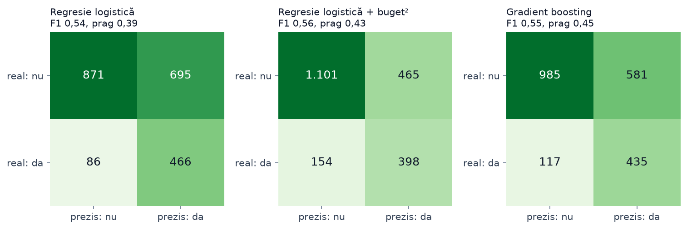

# Modele de bază și experimente (#41)

Generat cu `python modeling/baselines.py` (seed 42; rulat de două ori, dă aceleași cifre). Tabelele complete: `results/baselines/*.csv`; hiperparametrii: `results/baselines/best_params.json`.

## Protocol

- **Split temporal** (#40): train 1950–2014 (13.623 filme), validare 2015–2018 (2.313), test 2019–2024 (2.118, 26,1% profitabile).
- Fiecare model se antrenează pe train. **Hiperparametrii** se aleg pe validare (ROC-AUC la clasificare, RMSE pe `log_roi` la regresie), dintr-o grilă mică; fără validare încrucișată aleatoare, ca să nu intre filme din viitor în antrenare.
- **Pragul de decizie** al clasificatorilor (probabilitatea peste care spunem „profitabil”) se alege pe validare, ca F1 să fie maxim. Pragul implicit 0,5 nu e potrivit când doar o treime din filme sunt profitabile.
- **Testul** se folosește o singură dată, la final. Clasele sunt dezechilibrate, deci metrica principală e **F1** (și ROC-AUC, care nu depinde de prag); acuratețea singură înșală (vezi Dummy).
- Coloanele de intrare: cele 63 din #40 / #42, fără leakage. Regresia logistică și Ridge primesc date scalate; arborii, nescalate.

## Clasificare: `profitable` (ROI ≥ 2,5), pe test

| model | F1 | ROC-AUC | PR-AUC | precision | recall | accuracy | prag | F1 validare | AUC validare |
|---|---|---|---|---|---|---|---|---|---|
| Dummy (clasa majoritară) | 0,000 | 0,500 | 0,261 | 0,000 | 0,000 | 0,739 | 0,500 | 0,000 | 0,500 |
| Regresie logistică | 0,544 | 0,774 | 0,555 | 0,401 | 0,844 | 0,631 | 0,390 | 0,610 | 0,769 |
| Regresie logistică + buget² | 0,563 | 0,769 | 0,531 | 0,461 | 0,721 | 0,708 | 0,430 | 0,616 | 0,772 |
| Random Forest | 0,541 | 0,777 | 0,548 | 0,396 | 0,853 | 0,622 | 0,390 | 0,617 | 0,784 |
| Gradient boosting | 0,555 | 0,775 | 0,527 | 0,428 | 0,788 | 0,670 | 0,450 | 0,629 | 0,791 |

- **Baseline-ul trivial** (mereu „neprofitabil”) are acuratețe 73,9%, dar F1 = 0: nu găsește niciun film profitabil. Orice model trebuie judecat față de el pe F1 și ROC-AUC, nu pe acuratețe.
- **Cel mai bun model** după ROC-AUC pe test: **Random Forest** (ROC-AUC 0,777, F1 0,541).

### Hiperparametri aleși pe validare

| sarcină | model | hiperparametri aleși |
|---|---|---|
| clasificare | Dummy (clasa majoritară) | – |
| clasificare | Regresie logistică | C = 0.01 |
| clasificare | Regresie logistică + buget² | C = 10 |
| clasificare | Random Forest | max_depth = None, min_samples_leaf = 5, max_features = 0.3 |
| clasificare | Gradient boosting | learning_rate = 0.03, max_leaf_nodes = 31, min_samples_leaf = 50, l2_regularization = 1.0 |
| regresie | Dummy (mediana) | – |
| regresie | Ridge | alpha = 100 |
| regresie | Ridge + buget² | alpha = 10 |
| regresie | Random Forest | max_depth = None, min_samples_leaf = 5, max_features = 0.3 |
| regresie | Gradient boosting | learning_rate = 0.1, max_leaf_nodes = 15, min_samples_leaf = 20, l2_regularization = 0.0 |

## Regresie: `log_roi`, pe test

| model | RMSE log_roi | MAE log_roi | R² log_roi | MAE ROI | MedAE ROI | F1 din regresie | RMSE validare |
|---|---|---|---|---|---|---|---|
| Dummy (mediana) | 2,013 | 1,509 | -0,133 | 2,380 | 1,154 | 0,000 | 1,873 |
| Ridge | 1,644 | 1,251 | 0,245 | 2,125 | 0,568 | 0,183 | 1,595 |
| Ridge + buget² | 1,636 | 1,255 | 0,252 | 2,130 | 0,545 | 0,190 | 1,590 |
| Random Forest | 1,650 | 1,224 | 0,239 | 2,079 | 0,706 | 0,371 | 1,532 |
| Gradient boosting | 1,666 | 1,243 | 0,224 | 2,138 | 0,759 | 0,454 | 1,509 |

- RMSE și MAE sunt pe `log_roi` (o eroare de 1 înseamnă un ROI greșit de aproximativ e ≈ 2,7 ori). MAE pe ROI e dominat de câteva filme cu ROI uriaș; mediana erorii absolute (MedAE) descrie mai bine un film obișnuit.
- „F1 din regresie”: regresia folosită ca un clasificator (ROI prezis ≥ 2,5), comparabilă cu tabelul de clasificare.
- **Cel mai bun model** după RMSE: **Ridge + buget²** (RMSE 1,636, R² 0,252).

## Experimente (clasificare, pe test)

Fiecare rând schimbă **o singură** decizie față de varianta principală, pe regresia logistică și pe gradient boosting, cu hiperparametrii aleși mai sus.

| experiment | model | F1 | ROC-AUC | PR-AUC | precision | recall | accuracy | prag | observații |
|---|---|---|---|---|---|---|---|---|---|
| principal | Regresie logistică | 0,544 | 0,774 | 0,555 | 0,401 | 0,844 | 0,631 | 0,390 |  |
| fără class_weight | Regresie logistică | 0,544 | 0,774 | 0,555 | 0,401 | 0,844 | 0,631 | 0,240 |  |
| prag fix 0,5 | Regresie logistică | 0,556 | 0,774 | 0,555 | 0,491 | 0,641 | 0,733 | 0,500 |  |
| cu leakage (voturi + keywords) | Regresie logistică | 0,625 | 0,834 | 0,659 | 0,566 | 0,697 | 0,782 | 0,480 |  |
| fără outliers în train | Regresie logistică | 0,564 | 0,774 | 0,554 | 0,456 | 0,739 | 0,703 | 0,460 | 620 filme scoase (log_roi în afara 1,5×IQR) |
| fără premii | Regresie logistică | 0,543 | 0,774 | 0,556 | 0,400 | 0,844 | 0,630 | 0,390 |  |
| test fără 2020–2021 | Regresie logistică | 0,573 | 0,772 | 0,572 | 0,432 | 0,850 | 0,634 | 0,390 | 1570 filme |
| test, surse de acord | Regresie logistică | 0,613 | 0,714 | 0,608 | 0,483 | 0,837 | 0,595 | 0,390 | 817 filme cu buget și încasări confirmate de ≥ 2 surse |
| split stratificat | Regresie logistică | 0,577 | 0,748 | 0,583 | 0,463 | 0,765 | 0,643 | 0,450 | aleator 70/15/15, doar pentru comparație |
| principal | Gradient boosting | 0,555 | 0,775 | 0,527 | 0,428 | 0,788 | 0,670 | 0,450 |  |
| fără class_weight | Gradient boosting | 0,557 | 0,770 | 0,522 | 0,431 | 0,788 | 0,674 | 0,300 |  |
| prag fix 0,5 | Gradient boosting | 0,556 | 0,775 | 0,527 | 0,452 | 0,721 | 0,700 | 0,500 |  |
| cu leakage (voturi + keywords) | Gradient boosting | 0,661 | 0,867 | 0,689 | 0,648 | 0,676 | 0,820 | 0,600 |  |
| fără outliers în train | Gradient boosting | 0,552 | 0,773 | 0,527 | 0,441 | 0,737 | 0,688 | 0,490 | 620 filme scoase (log_roi în afara 1,5×IQR) |
| fără premii | Gradient boosting | 0,550 | 0,773 | 0,528 | 0,418 | 0,806 | 0,657 | 0,430 |  |
| test fără 2020–2021 | Gradient boosting | 0,589 | 0,775 | 0,553 | 0,467 | 0,800 | 0,678 | 0,450 | 1570 filme |
| test, surse de acord | Gradient boosting | 0,596 | 0,689 | 0,547 | 0,479 | 0,789 | 0,590 | 0,450 | 817 filme cu buget și încasări confirmate de ≥ 2 surse |
| split stratificat | Gradient boosting | 0,604 | 0,781 | 0,638 | 0,508 | 0,746 | 0,689 | 0,460 | aleator 70/15/15, doar pentru comparație |
| imputare knn | Regresie logistică | 0,540 | 0,775 | 0,561 | 0,396 | 0,850 | 0,623 | 0,390 |  |
| imputare iterative | Regresie logistică | 0,542 | 0,776 | 0,557 | 0,400 | 0,841 | 0,630 | 0,390 |  |

## Experimente (regresie, pe test)

| experiment | model | RMSE log_roi | MAE log_roi | R² log_roi | MedAE ROI |
|---|---|---|---|---|---|
| principal | Ridge | 1,644 | 1,251 | 0,245 | 0,568 |
| cu leakage | Ridge | 1,525 | 1,161 | 0,350 | 0,525 |
| fără outliers în train | Ridge | 1,685 | 1,257 | 0,206 | 0,646 |
| principal | Gradient boosting | 1,666 | 1,243 | 0,224 | 0,759 |
| cu leakage | Gradient boosting | 1,440 | 1,041 | 0,420 | 0,574 |
| fără outliers în train | Gradient boosting | 1,712 | 1,266 | 0,181 | 0,806 |

## Concluzii

1. **Toate modelele reale bat clar baseline-ul**, dar ajung la același plafon: ROC-AUC 0,77–0,78 pe
   test, F1 0,54–0,56. Diferența dintre regresia logistică și gradient boosting e mică (sub 0,01 la
   ROC-AUC). Limita vine din informația disponibilă înainte de lansare, nu din model; dacă un model
   e semnificativ mai bun decât altul se testează în #56 (bootstrap, McNemar).
2. **Bugetul la pătrat ajută modelul liniar** să prindă forma de U din EDA: F1 0,544 → 0,563 la
   regresia logistică (la ROC-AUC diferența e în marja de zgomot), iar Ridge + buget² are cel mai mic
   RMSE la regresie. Arborii o prind singuri.
3. **Leakage-ul se vede imediat:** cu voturile și keywords TMDB (cunoscute abia după lansare),
   ROC-AUC urcă de la 0,775 la 0,867 la gradient boosting, iar R² la regresie de la 0,22 la 0,42.
   Un model care le folosește ar părea mult mai bun decât e în realitate; de aceea sunt excluse (#54).
4. **Dezechilibrul de clase se rezolvă prin prag, nu prin ponderi:** fără `class_weight`, regresia
   logistică dă exact aceleași predicții după ce pragul e ales pe validare (0,24 în loc de 0,39);
   ponderile doar mută probabilitățile. Contează ca pragul să fie ales, nu lăsat la 0,5.
5. **Pragul ales pe validare nu se transferă perfect pe test:** validarea are 33,5% profitabile, testul
   26,1%. La regresia logistică, pragul fix 0,5 dă pe test un F1 ușor mai mare (0,556 vs 0,544). Asta e
   o schimbare a ratei de bază în timp (COVID, §EDA), de urmărit în analiza erorilor (#57).
6. **COVID:** fără 2020–2021, F1 crește la 0,57–0,59, iar ROC-AUC rămâne la fel: modelul ordonează
   filmele la fel de bine, dar în acei ani mai puține filme au trecut pragul.
7. **Calitatea țintei:** pe cele 817 filme de test cu buget și încasări confirmate de cel puțin 2 surse,
   F1 crește (0,60–0,61), dar ROC-AUC scade (0,69–0,71). Subsetul e diferit (38% profitabile, filme
   mai cunoscute), deci nu e o comparație directă; o reluăm în #57, pe segmente.
8. **Outliers, premii, imputare:** fără outliers în train, clasificarea rămâne practic la fel, dar
   regresia pierde (R² 0,25 → 0,21 la Ridge): filmele cu ROI extrem sunt reale și utile. Fără premii,
   rezultatele nu se schimbă (premiile aduc foarte puțin, cum arăta EDA). Imputarea kNN sau
   iterativă dă același rezultat ca mediana, deci păstrăm mediana (mai simplă).
9. **Split stratificat vs temporal:** gradient boosting are F1 0,604 pe un test aleator față de 0,555
   pe testul temporal. Un split aleator ar fi supraestimat performanța reală, pe filme viitoare.
10. **Regresia e mai grea decât clasificarea:** R² ≈ 0,25 pe `log_roi`, iar folosită ca clasificator
   (ROI prezis ≥ 2,5) dă F1 de 0,18–0,45, mult sub clasificatorii direcți. Pentru decizia „profitabil
   sau nu” folosim clasificarea; regresia rămâne pentru a estima cât de mare e ROI-ul.
