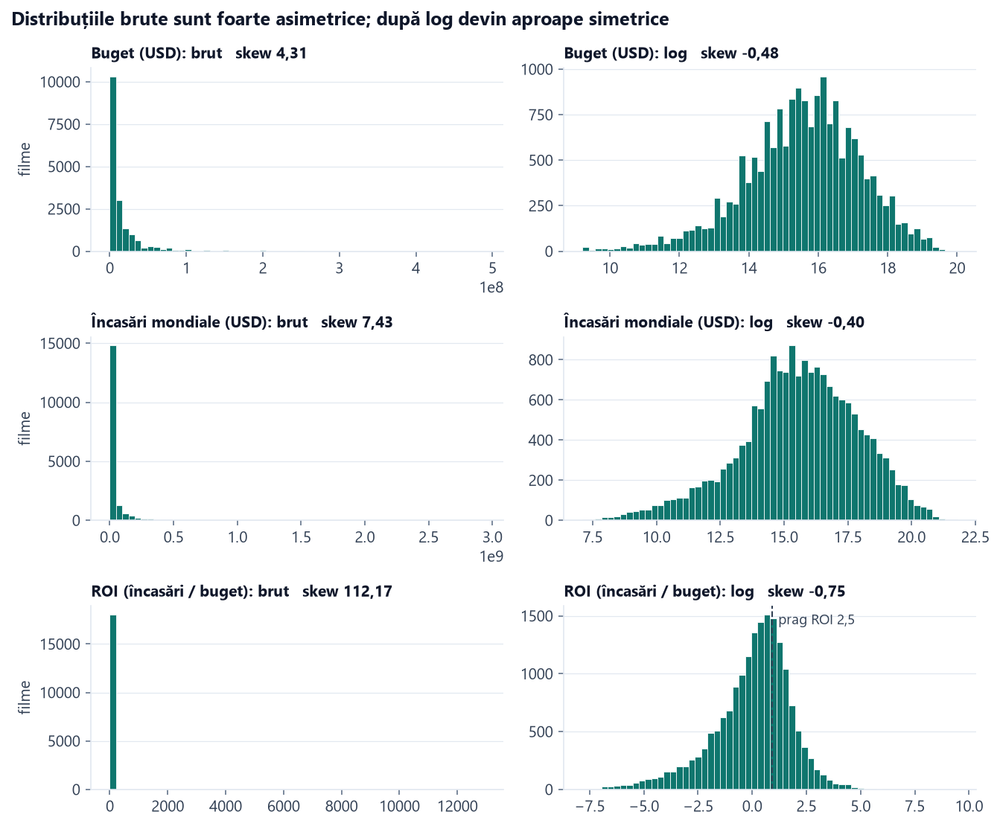
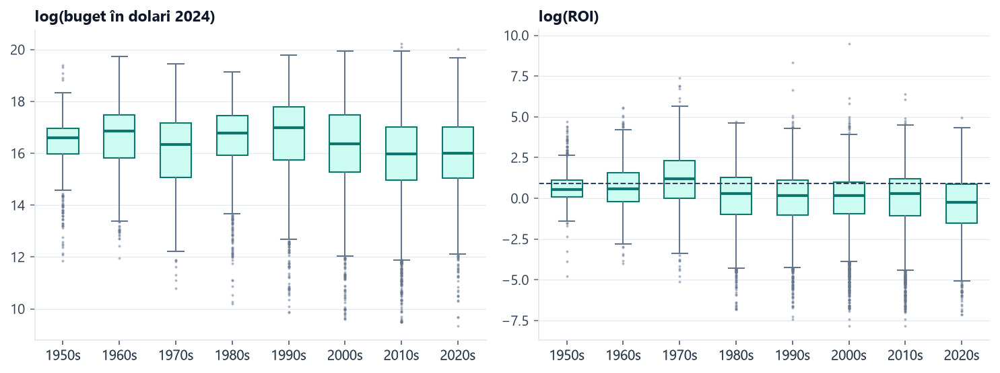
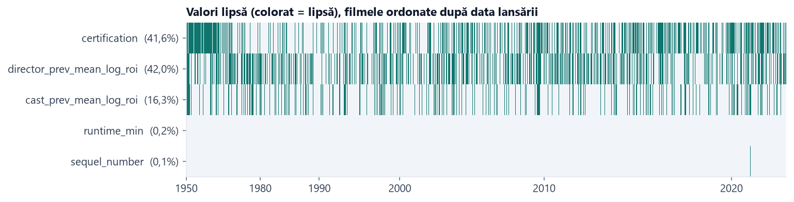
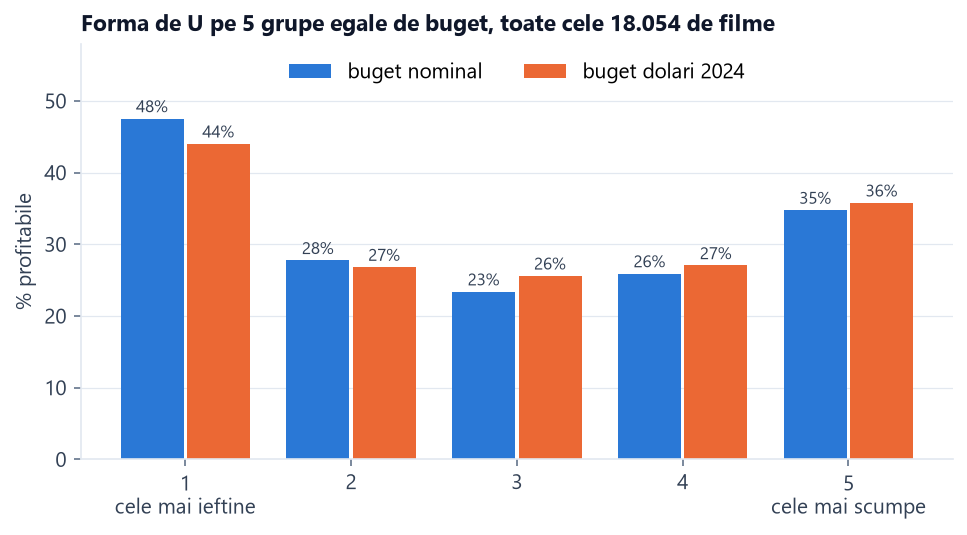
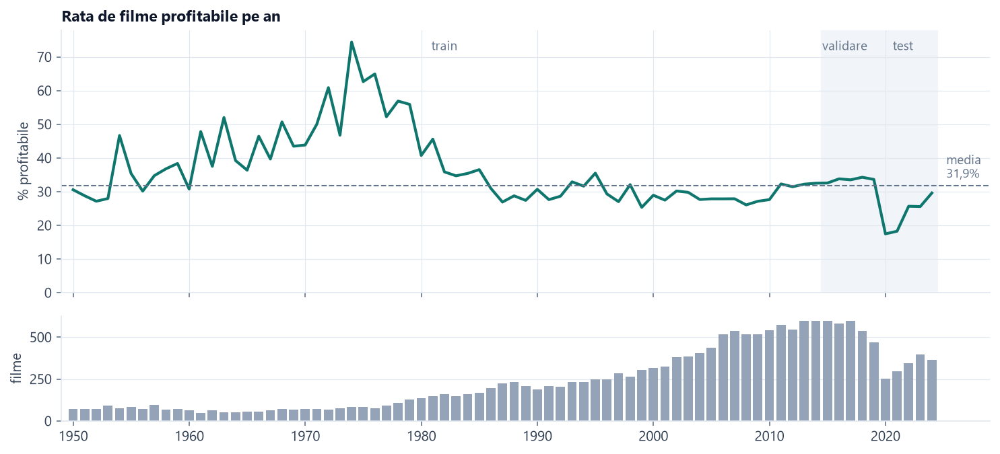
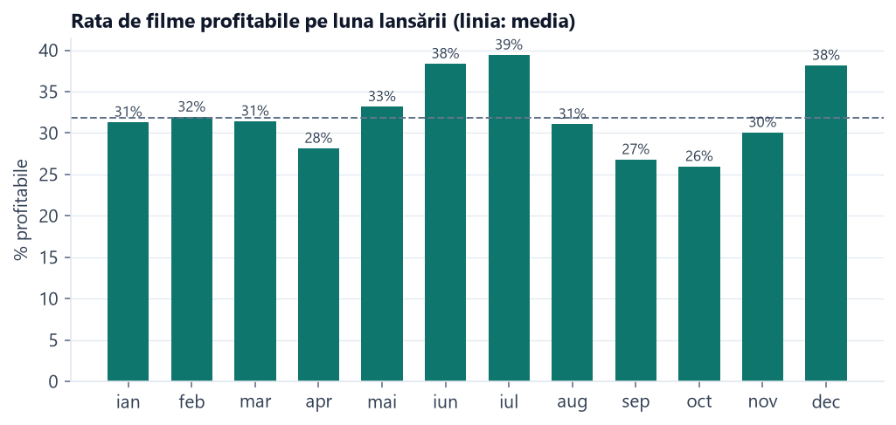
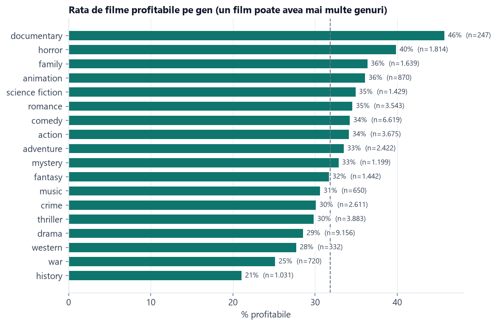
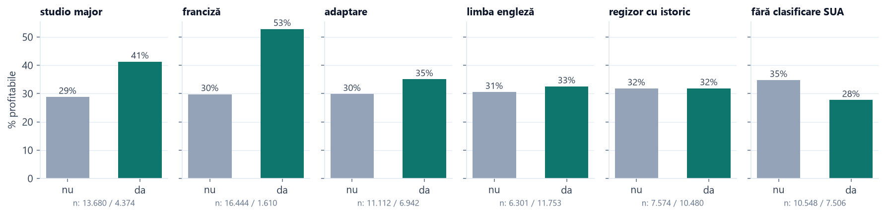
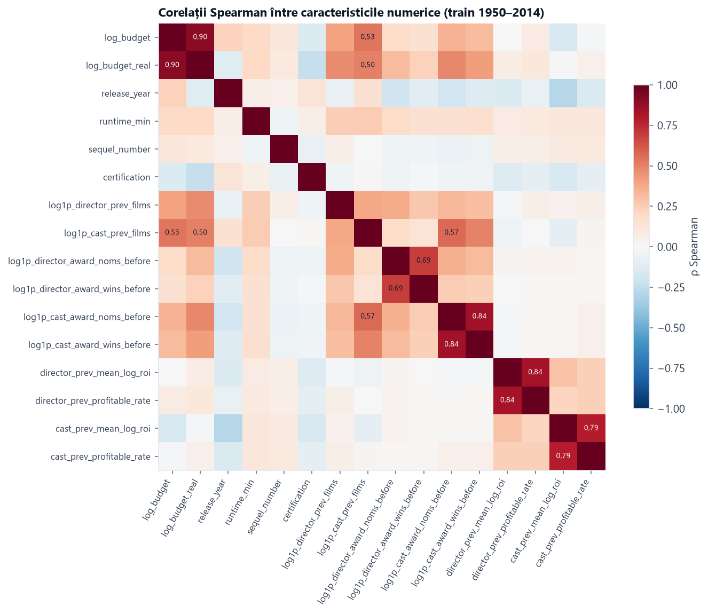
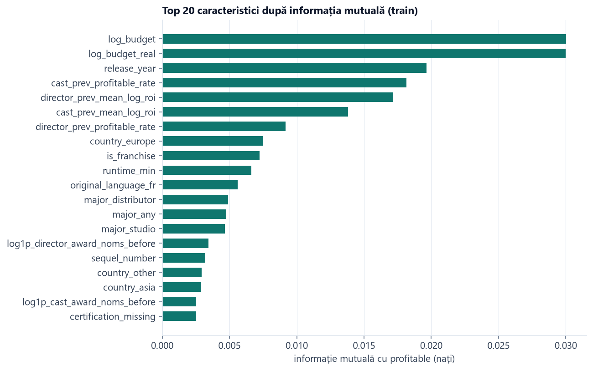

# Analiza exploratorie (#42)

Generat cu `python analysis/eda.py`. Tabelele complete: `results/eda/*.csv`; figurile: `docs/figures/eda_*.png`.

Dataset: **18,054 filme** (după scoaterea a 2 duplicate, vezi §8), 31,9% profitabile (ROI ≥ 2,5). Statisticile descriptive, outliers și datele lipsă sunt pe tot dataset-ul; redundanța și relevanța față de țintă sunt calculate **doar pe train-ul temporal** (1950–2014, 13,623 filme), ca decizia de a scoate o caracteristică să nu vadă filmele de test.

## Pe scurt

1. **Banii sunt foarte asimetrici.** ROI are skewness 112,17 și kurtosis 13.677: media (4,90) e de 3,7 ori mediana (1,33), din cauza câtorva filme cu buget mic și încasări uriașe (Paranormal Activity: ROI 12.947). După log, skewness scade la -0,75. Modelele lucrează pe `log_budget_real` și `log_roi` (#40).
2. **Forma de U pe buget** se păstrează pe toate filmele, nominal (48% / 28% / 23% / 26% / 35%) și în dolari 2024 (44% / 27% / 26% / 27% / 36%): filmele foarte ieftine și cele foarte scumpe sunt mai des profitabile decât cele de mijloc. Un model liniar pe `log_budget_real` nu poate prinde un U (ar avea nevoie de un termen pătratic, de testat în #41); arborii pot.
3. **Rata de profitabile se schimbă în timp**: anii '70 au cea mai mare rată (56,9%), iar setul de test (2019–2024) are 26,1%, cu minimul în 2020 și 2021 (COVID: 17,5% și 18,2%).
4. **Cele mai informative caracteristici** (informație mutuală, pe train): `log_budget`, `log_budget_real`, `release_year`, `cast_prev_profitable_rate`, `director_prev_mean_log_roi`. Bugetul, anul lansării și istoricul actorilor și al regizorului poartă cel mai mult semnal, dar fiecare efect e mic luat separat (cea mai mare corelație cu ținta: 0,16), deci ținta nu se prezice dintr-o singură coloană.
5. **Redundanță**: 4 coloane se calculează exact din altele și ies din model (§9): `log_budget`, `major_any`, `is_english`, `is_adaptation`. După ele, modelul primește 63 de coloane.

## 1. Tipuri de date

| caracteristică | tip | observații |
|---|---|---|
| budget | raport (continuă) | USD nominal; zero absolut |
| release_year | interval (discretă) | anul nu are zero natural |
| release_month | ordinală ciclică | 1–12, decembrie vecină cu ianuarie |
| release_weekday | ordinală ciclică | 0–6 |
| runtime_min | raport (discretă) | minute |
| certification | ordinală | G < PG < PG-13 < R < NC-17 |
| sequel_number | raport (discretă) | 0 = nu e continuare |
| director_prev_films, cast_prev_films | raport (numărătoare) |  |
| *_award_noms_before, *_award_wins_before | raport (numărătoare) | 4 coloane |
| director_prev_mean_roi / _mean_log_roi | raport / interval | log-ul poate fi negativ |
| *_prev_profitable_rate | raport (proporție) | 0–1 |
| original_language | nominală | 7 categorii |
| adaptation_type | nominală | 10 categorii |
| genre_* (18) | binară asimetrică | 1 = filmul are genul; 0 nu spune nimic despre film |
| country_* (4) | binară asimetrică | o țară de producție poate fi în mai multe grupe |
| major_studio, major_distributor, major_any, streaming_distributor | binară asimetrică |  |
| is_franchise, is_adaptation | binară asimetrică |  |
| is_english | binară simetrică | ambele valori sunt la fel de informative |
| profitable (țintă) | binară simetrică | ROI ≥ 2,5 |
| roi (țintă) | raport (continuă) | încasări / buget |

Binarele **asimetrice** (genuri, țări, studio) au un „1” informativ și un „0” care înseamnă doar „nu știm / nu e cazul”: pentru similaritate se folosește Jaccard, nu potrivirea simplă. `is_english` e **simetrică**.

## 2. Statistici descriptive

| coloană | n | medie | mediană | medie trunchiată 10% | mod | min | Q1 | Q3 | max | IQR | std | skewness | kurtosis |
|---|---|---|---|---|---|---|---|---|---|---|---|---|---|
| budget | 18.054 | 16.974.329,19 | 6.000.000,00 | 9.835.374,91 | 10.000.000,00 | 10.000,00 | 2.000.000,00 | 18.000.000,00 | 489.900.000,00 | 16.000.000,00 | 31.033.914,76 | 4,31 | 26,16 |
| log_budget | 18.054 | 15,54 | 15,61 | 15,61 | 16,12 | 9,21 | 14,51 | 16,71 | 20,01 | 2,20 | 1,65 | -0,48 | 0,51 |
| log_budget_real | 18.054 | 16,22 | 16,38 | 16,31 | 16,39 | 9,34 | 15,29 | 17,33 | 20,21 | 2,04 | 1,59 | -0,64 | 0,77 |
| worldwide_gross | 18.054 | 43.642.766,01 | 6.233.728,50 | 16.261.472,03 | 2.000.000,00 | 1.219,00 | 1.432.923,50 | 29.300.000,00 | 2.940.000.000,00 | 27.867.076,50 | 124.926.780,77 | 7,43 | 87,86 |
| log_gross | 18.054 | 15,55 | 15,65 | 15,65 | 14,51 | 7,11 | 14,18 | 17,19 | 21,80 | 3,02 | 2,33 | -0,40 | 0,16 |
| roi | 18.054 | 4,90 | 1,33 | 1,83 | 1,00 | 0,00 | 0,41 | 3,20 | 12.946,67 | 2,79 | 103,52 | 112,17 | 13.676,99 |
| log_roi | 18.054 | 0,01 | 0,28 | 0,14 | 0,00 | -7,82 | -0,89 | 1,16 | 9,47 | 2,06 | 1,81 | -0,75 | 1,29 |
| runtime_min | 18.021 | 109,58 | 105,00 | 106,92 | 90,00 | 40,00 | 94,00 | 120,00 | 422,00 | 26,00 | 22,52 | 1,53 | 6,15 |
| release_year | 18.054 | 2.001,28 | 2.006,00 | 2.003,58 | 2.014,00 | 1.950,00 | 1.992,00 | 2.014,00 | 2.024,00 | 22,00 | 17,52 | -1,08 | 0,54 |
| director_prev_films | 18.054 | 2,42 | 1,00 | 1,54 | 0,00 | 0,00 | 0,00 | 3,00 | 47,00 | 3,00 | 3,95 | 3,25 | 16,43 |
| cast_prev_films | 18.054 | 9,44 | 5,00 | 7,34 | 0,00 | 0,00 | 1,00 | 14,00 | 100,00 | 13,00 | 11,34 | 2,18 | 7,04 |
| director_prev_mean_roi | 10.480 | 7,36 | 2,73 | 3,26 | 2,00 | 0,00 | 1,41 | 4,93 | 12.946,67 | 3,52 | 134,01 | 88,79 | 8.382,25 |
| director_prev_mean_log_roi | 10.480 | 0,54 | 0,63 | 0,60 | 0,69 | -6,84 | -0,02 | 1,24 | 9,47 | 1,26 | 1,28 | -0,75 | 3,81 |
| director_prev_profitable_rate | 10.480 | 0,42 | 0,40 | 0,41 | 0,00 | 0,00 | 0,00 | 0,67 | 1,00 | 0,67 | 0,37 | 0,31 | -1,23 |
| cast_prev_mean_log_roi | 15.116 | 0,32 | 0,36 | 0,34 | 1,39 | -6,78 | -0,20 | 0,86 | 8,33 | 1,06 | 1,01 | -0,24 | 4,41 |
| cast_award_noms_before | 18.054 | 1,66 | 0,00 | 0,74 | 0,00 | 0,00 | 0,00 | 2,00 | 60,00 | 2,00 | 3,68 | 3,93 | 22,89 |

- `budget`: media (17,0 mil. $) e mult peste mediană (6,0 mil. $); skewness 4,31 → -0,48 după log.
- Media trunchiată (10% din fiecare capăt) e aproape de mediană la toate coloanele de bani: diferența dintre medie și mediană vine doar din cozi.
- `director_prev_mean_roi` are aceeași problemă ca ROI (kurtosis 8.382); de aceea modelul folosește `director_prev_mean_log_roi` (#40).

## 3. Outliers

| coloană | sub 1,5×IQR | peste 1,5×IQR | % IQR | |z| > 3 | limite IQR |
|---|---|---|---|---|---|
| budget | 0 | 1735 | 9,6% | 421 | [-22.000.000,00; 42.000.000,00] |
| log_budget | 259 | 1 | 1,4% | 123 | [11,21; 20,00] |
| worldwide_gross | 0 | 2503 | 13,9% | 339 | [-40.367.691,25; 71.100.614,75] |
| log_gross | 252 | 2 | 1,4% | 66 | [9,65; 21,72] |
| roi | 0 | 1673 | 9,3% | 13 | [-3,78; 7,39] |
| log_roi | 631 | 100 | 4,0% | 204 | [-3,98; 4,25] |
| runtime_min | 15 | 704 | 4,0% | 225 | [55,00; 159,00] |

- Pe datele brute, regula 1,5×IQR marchează mii de filme ca outliers, pentru că distribuția are o coadă lungă, nu pentru că valorile sunt greșite. Pe log, numărul scade mult: regula se aplică pe `log_roi`, nu pe ROI.
- Experimentul cu / fără outliers din #41 folosește limitele IQR pe `log_roi` (calculate pe train).

**Cele mai mari ROI-uri** (reale, nu erori: filme cu buget foarte mic devenite fenomene):

| title | release_year | budget | worldwide_gross | roi |
|---|---|---|---|---|
| Paranormal Activity | 2.009 | 15.000 | 194.200.000 | 12.947 |
| The Blair Witch Project | 1.999 | 60.000 | 248.600.000 | 4.143 |
| Deep Throat | 1.975 | 25.000 | 40.000.000 | 1.600 |
| Fist of Fury | 1.972 | 100.000 | 100.000.000 | 1.000 |
| The Way of the Dragon | 1.972 | 130.000 | 130.000.000 | 1.000 |
| Behind the Green Door | 1.972 | 60.000 | 50.000.000 | 833 |
| The Brothers McMullen | 1.995 | 25.000 | 19.300.000 | 772 |
| One Cut of the Dead | 2.017 | 52.406 | 31.200.000 | 595 |
| Enter the Dragon | 1.973 | 850.000 | 400.000.000 | 471 |
| Open Water | 2.004 | 120.000 | 55.500.000 | 462 |

**Cele mai mici ROI-uri** (încasări de câteva mii de dolari: lansări aproape doar simbolice):

| title | release_year | budget | worldwide_gross | roi |
|---|---|---|---|---|
| Gooby | 2.009 | 6.500.000 | 2.834 | 0,0004 |
| Speed Kills | 2.018 | 15.000.000 | 5.812 | 0,0004 |
| Philadelphia Experiment II | 1.994 | 5.000.000 | 2.970 | 0,0006 |
| Absolon | 2.003 | 8.000.000 | 5.008 | 0,0006 |
| Crazy Eyes | 2.012 | 10.000.000 | 6.106 | 0,0006 |

## 4. Date lipsă

| coloană | lipsă | % |
|---|---|---|
| director_prev_mean_log_roi | 7.574 | 42,0% |
| director_prev_profitable_rate | 7.574 | 42,0% |
| director_prev_mean_roi | 7.574 | 42,0% |
| certification | 7.506 | 41,6% |
| cast_prev_mean_log_roi | 2.938 | 16,3% |
| cast_prev_profitable_rate | 2.938 | 16,3% |
| cast_prev_mean_roi | 2.938 | 16,3% |
| runtime_min | 33 | 0,2% |
| sequel_number | 13 | 0,1% |

**Lipsa `certification`**: depinde puternic de limbă și de țara de producție (test χ²):

| grupă | lipsă dacă 1 | lipsă dacă 0 | χ² | p |
|---|---|---|---|---|
| limba engleză | 18,8% | 84,1% | 7.213,16 | < 1e-300 |
| producție SUA | 15,2% | 76,4% | 6.810,09 | < 1e-300 |
| studio / distribuitor major | 12,5% | 58,9% | 3.735,21 | < 1e-300 |
| profitabil | 36,2% | 44,1% | 100,88 | 9.8e-24 |

Lipsa e explicată în mare parte de coloane pe care le avem (limbă, țară), deci e cel puțin **MAR**. Rămâne o legătură cu ținta și în interiorul fiecărei grupe limbă × țară (lipsa nu e doar o chestiune de limbă):

| is_english | country_us | filme | profitabile cu clasificare | profitabile fără clasificare |
|---|---|---|---|---|
| 0 | 0 | 6.105 | 36,5% | 29,5% |
| 0 | 1 | 196 | 36,5% | 29,7% |
| 1 | 0 | 1.670 | 23,6% | 15,9% |
| 1 | 1 | 10.083 | 35,8% | 27,5% |

Diferența din fiecare grupă sugerează o componentă **MNAR**: filmele fără lansare clasificată în SUA sunt, de obicei, filme mai mici. De aceea #40 păstrează indicatorul `certification_missing` în loc să completeze doar cu mediana: indicatorul e el însuși o informație.

Istoricul regizorului / actorilor lipsește **structural** (primul film, verificat în #40), iar `runtime_min` și `sequel_number` au sub 0,3% lipsă.

## 5. Ce se vede față de țintă

| buget | grupa | % profitabile | filme | limita superioară (mil. $) |
|---|---|---|---|---|
| nominal | 1 | 47,5% | 3.611 | 1,51 |
| nominal | 2 | 27,8% | 3.612 | 4,10 |
| nominal | 3 | 23,4% | 3.616 | 9,40 |
| nominal | 4 | 25,9% | 3.649 | 22,00 |
| nominal | 5 | 34,8% | 3.566 | – |
| dolari 2024 | 1 | 44,0% | 3.611 | 3,25 |
| dolari 2024 | 2 | 26,8% | 3.616 | 8,59 |
| dolari 2024 | 3 | 25,6% | 3.608 | 18,83 |
| dolari 2024 | 4 | 27,1% | 3.615 | 41,41 |
| dolari 2024 | 5 | 35,8% | 3.604 | – |

## 6. Redundanță (train)

**Perechi numerice cu |ρ Spearman| ≥ 0,6:**

| a | b | Pearson | Spearman |
|---|---|---|---|
| log_budget | log_budget_real | 0,92 | 0,90 |
| log1p_cast_award_noms_before | log1p_cast_award_wins_before | 0,89 | 0,84 |
| director_prev_mean_log_roi | director_prev_profitable_rate | 0,74 | 0,84 |
| cast_prev_mean_log_roi | cast_prev_profitable_rate | 0,75 | 0,79 |
| log1p_director_award_noms_before | log1p_director_award_wins_before | 0,81 | 0,69 |

**Perechi categorice / binare cu V Cramér ≥ 0,5:**

| a | b | V Cramér |
|---|---|---|
| is_english | original_language | 1,00 |
| is_adaptation | adaptation_type | 1,00 |
| major_distributor | major_any | 0,98 |
| original_language | country_us | 0,77 |
| is_english | country_us | 0,77 |
| original_language | country_asia | 0,77 |
| major_studio | major_any | 0,74 |
| major_studio | major_distributor | 0,70 |
| original_language | certification_missing | 0,59 |
| is_english | certification_missing | 0,58 |
| country_us | certification_missing | 0,57 |
| is_english | country_asia | 0,55 |

## 7. Relevanță față de țintă (train)

Pentru fiecare dintre cele 67 coloane după preprocesare: informația mutuală (MI) cu `profitable`, corelația punct-biserială (r) cu `profitable` și p-valoarea ei, ρ Spearman cu `log_roi`, χ² (doar pentru coloanele 0/1), importanța într-un Random Forest (300 de arbori) și coeficientul unei regresii logistice cu penalizare L1 (Lasso, C = 0,1, date scalate). Tabelul include și cele 4 coloane scoase ca redundante (§9); ele nu au coeficient L1, pentru că nu intră în model. Top 20 după MI:

| caracteristică | MI | r (profitable) | p | ρ (log_roi) | χ² | importanță RF | coef. L1 |
|---|---|---|---|---|---|---|---|
| log_budget | 0,030 | -0,129 | 5.5e-52 | -0,090 | – | 0,103 | – |
| log_budget_real | 0,030 | -0,097 | 8.1e-30 | -0,017 | – | 0,088 | -0,699 |
| release_year | 0,020 | -0,088 | 1.3e-24 | -0,124 | – | 0,070 | -0,241 |
| cast_prev_profitable_rate | 0,018 | 0,142 | 1.2e-62 | 0,179 | – | 0,058 | 0,057 |
| director_prev_mean_log_roi | 0,017 | 0,141 | 8.8e-62 | 0,173 | – | 0,051 | 0,121 |
| cast_prev_mean_log_roi | 0,014 | 0,162 | 4.8e-81 | 0,227 | – | 0,071 | 0,129 |
| director_prev_profitable_rate | 0,009 | 0,129 | 5.0e-52 | 0,148 | – | 0,030 | 0,097 |
| country_europe | 0,008 | -0,121 | 2.1e-45 | -0,158 | 136,035 | 0,013 | -0,068 |
| is_franchise | 0,007 | 0,124 | 6.1e-48 | 0,129 | 193,595 | 0,013 | 0,804 |
| runtime_min | 0,007 | 0,092 | 5.7e-27 | 0,119 | – | 0,071 | 0,393 |
| original_language_fr | 0,006 | -0,100 | 2.2e-31 | -0,107 | 125,878 | 0,004 | 0,000 |
| major_distributor | 0,005 | 0,099 | 3.1e-31 | 0,159 | 81,648 | 0,015 | 0,587 |
| major_any | 0,005 | 0,098 | 2.2e-30 | 0,157 | 77,735 | 0,014 | – |
| major_studio | 0,005 | 0,098 | 3.8e-30 | 0,156 | 94,706 | 0,011 | 0,238 |
| log1p_director_award_noms_before | 0,003 | -0,001 | 0,937 | 0,020 | – | 0,009 | -0,013 |
| sequel_number | 0,003 | 0,077 | 1.5e-19 | 0,130 | – | 0,013 | 0,055 |
| country_other | 0,003 | -0,074 | 4.8e-18 | -0,136 | 67,371 | 0,006 | -0,263 |
| country_asia | 0,003 | 0,077 | 2.0e-19 | 0,112 | 68,040 | 0,010 | 0,224 |
| log1p_cast_award_noms_before | 0,003 | -0,015 | 0,072 | 0,006 | – | 0,017 | 0,034 |
| certification_missing | 0,003 | -0,070 | 1.8e-16 | -0,070 | 41,791 | 0,016 | -0,781 |

- **Corecția Bonferroni:** cu 67 teste, pragul 0,05 devine 7.5e-04. Corelații semnificative: 46 fără corecție, **33 cu corecție**. Cu 13.623 de filme, chiar și corelații foarte mici ies semnificative; contează mărimea efectului, nu doar p.
- **Lasso:** câte dintre cele 63 de coloane ale modelului ajung la coeficient zero, în funcție de penalizare (C mic = penalizare mare): C = 0,01: 38, C = 0,05: 20, C = 0,10: 15, C = 1,00: 4. La C = 0,1 rămân la zero: `adaptation_type_comics`, `adaptation_type_infrequent_sklearn`, `adaptation_type_stage`, `adaptation_type_tv`, `genre_mystery`, `genre_science_fiction`, `genre_war`, `genre_western`, `has_director_history`, `log1p_cast_award_wins_before`, `month_cos`, `original_language_fr`, `original_language_hi`, `original_language_ru`, `streaming_distributor`. Lasso vede doar efecte liniare și independente; o coloană pusă la zero aici poate conta într-un arbore (prin interacțiuni), deci nu scoatem nimic doar pe baza lui.

## 8. Duplicate semantice

Perechile cu același titlu și același an în `data/processed/movies_dataset.parquet`, verificate manual:

| title | release_year | imdb_id | original_language | runtime_min | budget | worldwide_gross | decizie |
|---|---|---|---|---|---|---|---|
| A Better Life | 2.011 | tt1554091 | en | 98 | 10.000.000 | 1.700.000 | păstrat |
| A Better Life | 2.011 | tt2027265 | fr | 110 | 6.400.000 | 4.000.000 | păstrat |
| Alone | 2.020 | tt10192566 | en | 92 | 750.000 | 642.502 | scos: Alone (2020): cifrele sunt ale lui tt7711170, din același infobox Wikipedia |
| Alone | 2.020 | tt7711170 | en | 98 | 750.000 | 642.502 | păstrat |
| Beast | 2.022 | tt11301946 | other | 155 | 19.750.995 | 32.822.552 | păstrat |
| Beast | 2.022 | tt13223398 | en | 93 | 36.000.000 | 59.100.000 | păstrat |
| Chaos | 2.005 | tt0402910 | en | 106 | 30.000.000 | 7.000.000 | păstrat |
| Chaos | 2.005 | tt0405977 | en | 74 | 1.000.000 | 20.166 | păstrat |
| Pari | 2.018 | tt7329858 | hi | 135 | 2.600.000 | 6.053.564 | păstrat |
| Pari | 2.018 | tt7976502 | other | 112 | 142.575 | 410.428 | păstrat |
| Red Eye | 2.005 | tt0421239 | en | 85 | 26.000.000 | 96.200.000 | păstrat |
| Red Eye | 2.005 | tt0448707 | ko | 96 | 5.000.000 | 693.832 | păstrat |
| Soldier | 1.998 | tt0120157 | en | 99 | 75.000.000 | 14.600.000 | păstrat |
| Soldier | 1.998 | tt0211634 | hi | 156 | 1.999.546 | 9.423.315 | păstrat |
| The Message | 1.976 | tt0074896 | en | 178 | 17.000.000 | 5.000.000 | păstrat |
| The Message | 1.976 | tt0075143 | other | 206 | 17.000.000 | 5.000.000 | scos: The Message (1976), versiunea arabă: aceeași producție ca tt0074896, buget numărat de două ori |

- Majoritatea sunt **omonime**: filme diferite (alt `imdb_id`, altă limbă, alt buget). Rămân.
- **Alone (2020)**: două filme diferite, dar cu buget și încasări identice, ambele din același infobox Wikipedia. Pagina e a filmului `tt7711170` (confirmată și de DBpedia); `tt10192566` a primit cifrele altui film → scos.
- **The Message (1976)**: versiunea în engleză și cea în arabă, filmate simultan, aceeași producție și același buget. Wikipedia are un singur articol pentru ambele, deci bugetul ar fi numărat de două ori → păstrăm doar versiunea în engleză (`tt0074896`).
- Cele două filme sunt scoase în `modeling/preprocessing.py` (`DUPLICATES`), nu în dataset-ul final, ca decizia să fie vizibilă și reversibilă.

## 9. Propunere: ce scoatem din model

Regula: scoatem o coloană doar dacă e **redundantă exact** (se calculează din alte coloane ale
modelului) sau aproape (ρ sau V Cramér ≥ 0,9). Pentru relevanță mică nu scoatem nimic aici:
arborii pot folosi o coloană slabă în combinație cu altele, iar comparația cu / fără se face pe
validare, în #41.

| Coloană | Decizie | Motiv (verificat pe date) |
|---|---|---|
| `log_budget` (nominal) | **scos** | = `log_budget_real` − log(factorul CPI al anului), diferență maximă 4·10⁻¹⁵: cu `release_year` în model nu aduce nimic nou (ρ = 0,90 cu varianta reală). Păstrăm varianta reală: e comparabilă între ani, iar informația mutuală e practic aceeași (0,030 la ambele). |
| `major_any` | **scos** | = `major_studio` SAU `major_distributor` pe 100% din filme (V = 0,98 cu `major_distributor`). |
| `is_english` | **scos** | = `original_language == "en"` pe 100% din filme (V = 1,00); one-hot-ul limbii o conține deja. |
| `is_adaptation` | **scos** | = `adaptation_type != "none"` pe 100% din filme (V = 1,00). |
| `director_prev_mean_log_roi` / `_profitable_rate` | păstrate amândouă | ρ = 0,84 (sub 0,9). Media ROI-ului și proporția de hituri măsoară lucruri diferite (un hit uriaș vs hituri constante), iar Lasso le păstrează pe amândouă. |
| `cast_prev_mean_log_roi` / `_profitable_rate` | păstrate amândouă | ρ = 0,79; același motiv. |
| `*_award_noms_before` / `*_award_wins_before` | păstrate | ρ = 0,84 (actori) și 0,69 (regizori). Relevanța e foarte mică (corelație cu ținta sub 0,02, nesemnificativă după Bonferroni), dar au importanță nenulă în Random Forest. Varianta fără premii se testează în #41. |
| `country_*` vs `original_language` | păstrate | V = 0,77: legate, dar nu identice (filme în engleză produse în Europa, coproducții). |
| `certification_missing` vs limbă / țară | păstrat | V ≈ 0,58; e și o informație proprie (§4). |
| genurile | păstrate | Lasso pune la zero o parte dintre ele, dar rata de profitabile diferă mult între genuri (§5). |

Rezultat: **4 coloane scoase**, aplicate în `modeling/preprocessing.py` (`REPLACED`). Modelul
primește 63 de coloane după preprocesare (înainte: 67).
