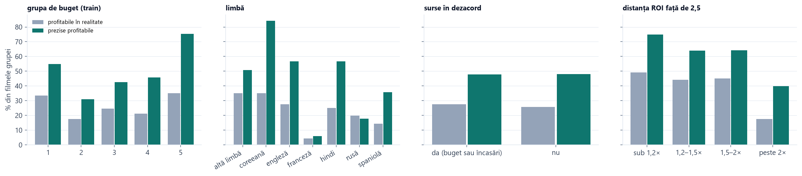
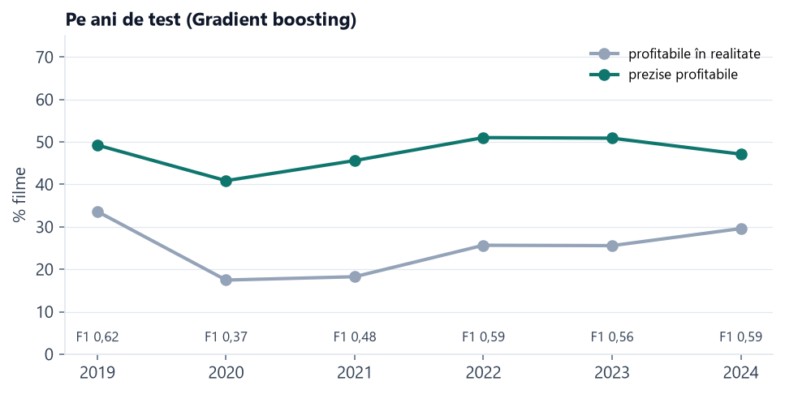
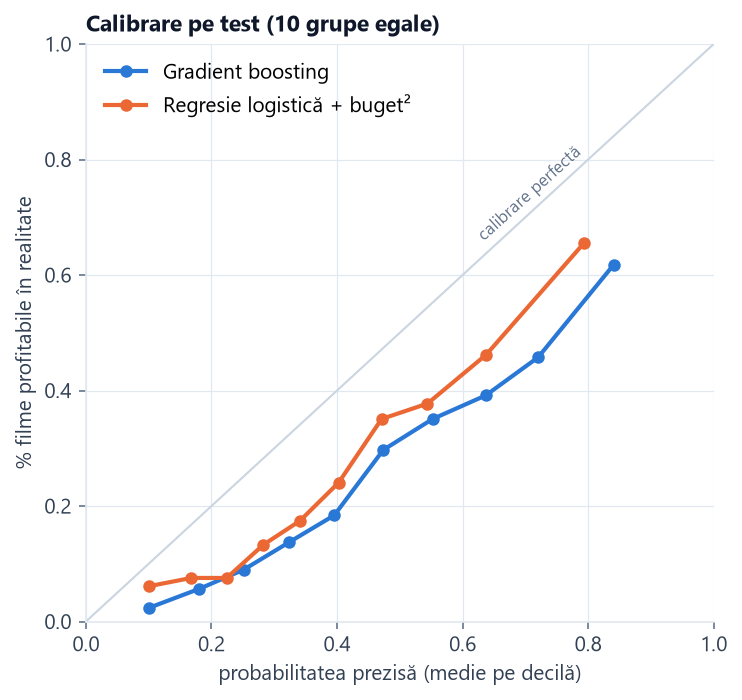
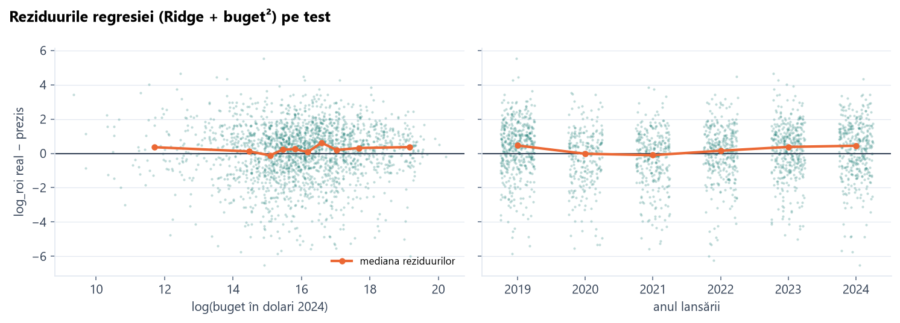

# Analiza erorilor (#57)

Generat cu `python analysis/errors.py`. Tabelele complete: `results/errors/*.csv`.

Testul temporal: **2.118 filme din 2019–2024**, 26,1% profitabile. Modelul principal: **Gradient boosting** (prag de decizie 0,45, ales pe validare); model de comparație: **Regresie logistică + buget²** (prag 0,43). Probabilitățile și pragurile vin din #56 (`results/compare/`).

## Pe scurt

1. **Modelul e prea optimist pe test.** Gradient boosting prezice 48,0% din filme ca profitabile, iar în
   realitate sunt 26,1%; probabilitatea medie prezisă e 44,8%. Modelul a învățat pe filme cu 32,5%
   profitabile (train), iar pragul a fost ales pe 33,5% (validare); testul are o rată mult mai mică
   (COVID, streaming). Consecința: recall mare (0,79), precizie mică (0,43). Gradient boosting
   e chiar **mai prost calibrat decât baseline-ul** (Brier 0,195 vs 0,193); regresia logistică + buget²
   e mai bine calibrată (Brier 0,178).
2. **Cele mai mari greșeli sunt la filmele mari de studio și francize:** la studiourile majore modelul
   prezice 89% profitabile, real 39% (52,6% greșite); la francize 81% vs 49%. Fals pozitivele cele mai
   sigure sunt blockbustere (Star Wars: The Rise of Skywalker, Fast X, Twisters, Mission: Impossible)
   care **au avut succes, dar sub pragul de 2,5** (ROI 1,96–2,40), plus filmele Warner din 2020–2021
   lansate simultan în cinema și pe HBO Max (Wonder Woman 1984, The Suicide Squad, Space Jam: A New
   Legacy), pe care coloana `streaming_distributor` nu le prinde (distribuitorul e Warner).
3. **Fals negativele sunt hituri-surpriză mici, mai ales din afara SUA:** comedii franceze, filme
   rusești pentru copii, un film chinezesc cu 674 mil. $ încasări (Full River Red), un film danez premiat
   (Another Round). Modelul nu are informații despre piața locală, iar regizorii lor nu au istoric în
   dataset.
4. **Aproape de prag, modelul ghicește:** pentru filmele cu ROI între 2,1 și 3 (cel mult 1,2× distanță de
   2,5), ROC-AUC e 0,45, adică sub nivelul unei alegeri aleatoare, cu 52% greșite. Pentru filmele cu ROI
   foarte departe de prag (peste 2× sau sub jumătate), ROC-AUC e 0,84. O mare parte din eroare vine din
   pragul fix: un film cu ROI 2,4 și unul cu ROI 2,6 sunt aproape identici, dar au etichete diferite.
5. **COVID:** în 2020–2021 doar 17,9% din filme au fost profitabile, dar modelul ordonează filmele la fel
   de bine ca în ceilalți ani (ROC-AUC 0,772 vs 0,775). F1 scade (0,43 vs 0,59) doar pentru că pragul
   nu se adaptează la rata de bază mai mică. Problema e de prag / calibrare, nu de ordonare.
6. **Sursele în dezacord nu explică erorile:** filmele cu buget sau încasări în dezacord între surse au
   34,2% greșite, față de 32,7% la celelalte (la regresia logistică: 30,4% vs 28,9%). Incertitudinea
   etichetei (#45: 87% din filmele care își schimbă eticheta au surse în dezacord) există, dar e mică
   față de restul erorii.
7. **Pe limbi, comportament foarte diferit:** filmele franțuzești din test sunt doar 4,3% profitabile, iar
   modelul le prezice corect ca neprofitabile (6,8% greșite); la cele coreene modelul nu ordonează deloc
   (ROC-AUC 0,47, doar 57 de filme), iar la hindi greșește 45%.
8. **Regresia:** reziduurile sunt pozitive în toate grupele de buget (mediană 0,14–0,40), deci modelul
   subestimează ușor ROI-ul tipic. Cele mai mari erori sunt filme cu ROI aproape 0: lansări de streaming
   cu o încasare simbolică în cinema (The Gray Man și White Noise, Netflix; Cinderella, Amazon), unde
   modelul prezice ROI 0,4–1,1. În test sunt 209 filme cu ROI sub 0,05 (9,9%, față de 6,3% în train).
   **Avengement (2019)** are încasările doar din TMDB (89,9 mil. $ pentru un film de acțiune britanic
   cu buget de 2,4 mil. $ și lansare foarte limitată în cinema, ROI 37), fără confirmare din altă
   sursă: foarte probabil o eroare de date, nu o eroare de model.

**Ce s-ar putea face:** recalibrarea probabilităților (de ex. Platt / izotonic pe validare) și alegerea
pragului după rata de bază așteptată; o variabilă pentru lansările simultane în cinema și streaming;
verificarea încasărilor venite dintr-o singură sursă (mai ales TMDB).

## 1. Erori pe segmente (Gradient boosting)

Pentru fiecare grupă: câte filme sunt profitabile în realitate, câte prezice modelul ca profitabile, precizia, recall-ul, F1, ROC-AUC (cât de bine ordonează filmele în grupă) și ce procent din filme e clasificat greșit. Grupele cu sub 30 de filme sunt omise. „Distanța ROI față de 2,5” e raportul dintre ROI și prag, în orice sens: sub 1,2× = ROI între 2,1 și 3; 1,2–1,5× = ROI 1,7–2,1 sau 3–3,75; 1,5–2× = ROI 1,25–1,7 sau 3,75–5; peste 2× = ROI sub 1,25 sau peste 5. Grupele de buget sunt cele 5 grupe egale din train, în mil. $ 2024: 1: 0,0–3,6, 2: 3,6–9,9, 3: 9,9–21,2, 4: 21,2–43,8, 5: 43,8–∞.

### grupa de buget (train)

| grupa de buget (train) | filme | % profitabile | % prezise profitabile | precision | recall | F1 | ROC-AUC | % greșite |
|---|---|---|---|---|---|---|---|---|
| 1 | 548 | 33,4% | 54,9% | 0,508 | 0,836 | 0,632 | 0,788 | 32,5% |
| 2 | 577 | 17,5% | 31,0% | 0,391 | 0,693 | 0,500 | 0,812 | 24,3% |
| 3 | 395 | 24,6% | 42,5% | 0,417 | 0,722 | 0,528 | 0,777 | 31,6% |
| 4 | 279 | 21,1% | 45,9% | 0,336 | 0,729 | 0,460 | 0,717 | 36,2% |
| 5 | 319 | 35,1% | 75,2% | 0,412 | 0,884 | 0,562 | 0,683 | 48,3% |

### gen principal

| gen principal | filme | % profitabile | % prezise profitabile | precision | recall | F1 | ROC-AUC | % greșite |
|---|---|---|---|---|---|---|---|---|
| Action | 317 | 28,1% | 55,8% | 0,390 | 0,775 | 0,519 | 0,697 | 40,4% |
| Adventure | 62 | 27,4% | 48,4% | 0,433 | 0,765 | 0,553 | 0,771 | 33,9% |
| Animation | 136 | 23,5% | 43,4% | 0,424 | 0,781 | 0,549 | 0,784 | 30,1% |
| Comedy | 352 | 26,7% | 51,7% | 0,418 | 0,809 | 0,551 | 0,771 | 35,2% |
| Crime | 81 | 18,5% | 48,1% | 0,256 | 0,667 | 0,370 | 0,703 | 42,0% |
| Drama | 497 | 20,3% | 40,0% | 0,357 | 0,703 | 0,473 | 0,764 | 31,8% |
| Family | 59 | 23,7% | 47,5% | 0,429 | 0,857 | 0,571 | 0,814 | 30,5% |
| Fantasy | 33 | 21,2% | 45,5% | 0,400 | 0,857 | 0,545 | 0,808 | 30,3% |
| History | 47 | 12,8% | 21,3% | 0,400 | 0,667 | 0,500 | 0,850 | 17,0% |
| Horror | 187 | 50,3% | 64,7% | 0,686 | 0,883 | 0,772 | 0,810 | 26,2% |
| Romance | 83 | 30,1% | 66,3% | 0,400 | 0,880 | 0,550 | 0,780 | 43,4% |
| Science Fiction | 66 | 21,2% | 47,0% | 0,452 | 1,000 | 0,622 | 0,837 | 25,8% |
| Thriller | 100 | 26,0% | 37,0% | 0,514 | 0,731 | 0,603 | 0,832 | 25,0% |
| War | 33 | 12,1% | 21,2% | 0,143 | 0,250 | 0,182 | 0,543 | 27,3% |

### limbă

| limbă | filme | % profitabile | % prezise profitabile | precision | recall | F1 | ROC-AUC | % greșite |
|---|---|---|---|---|---|---|---|---|
| altă limbă | 514 | 35,0% | 50,8% | 0,552 | 0,800 | 0,653 | 0,787 | 29,8% |
| coreeană | 57 | 35,1% | 84,2% | 0,375 | 0,900 | 0,529 | 0,470 | 56,1% |
| engleză | 1.008 | 27,5% | 56,6% | 0,394 | 0,812 | 0,531 | 0,744 | 39,5% |
| franceză | 234 | 4,3% | 6,0% | 0,286 | 0,400 | 0,333 | 0,822 | 6,8% |
| hindi | 148 | 25,0% | 56,8% | 0,321 | 0,730 | 0,446 | 0,679 | 45,3% |
| rusă | 101 | 19,8% | 17,8% | 0,611 | 0,550 | 0,579 | 0,799 | 15,8% |
| spaniolă | 56 | 14,3% | 35,7% | 0,300 | 0,750 | 0,429 | 0,755 | 28,6% |

### franciză

| franciză | filme | % profitabile | % prezise profitabile | precision | recall | F1 | ROC-AUC | % greșite |
|---|---|---|---|---|---|---|---|---|
| da | 271 | 48,7% | 80,8% | 0,580 | 0,962 | 0,724 | 0,716 | 35,8% |
| nu | 1.847 | 22,7% | 43,2% | 0,386 | 0,733 | 0,506 | 0,758 | 32,5% |

### studio major

| studio major | filme | % profitabile | % prezise profitabile | precision | recall | F1 | ROC-AUC | % greșite |
|---|---|---|---|---|---|---|---|---|
| da | 327 | 39,4% | 89,0% | 0,426 | 0,961 | 0,590 | 0,706 | 52,6% |
| nu | 1.791 | 23,6% | 40,5% | 0,429 | 0,735 | 0,542 | 0,782 | 29,4% |

### regizor cu istoric

| regizor cu istoric | filme | % profitabile | % prezise profitabile | precision | recall | F1 | ROC-AUC | % greșite |
|---|---|---|---|---|---|---|---|---|
| da | 1.258 | 26,6% | 49,4% | 0,435 | 0,808 | 0,565 | 0,772 | 33,0% |
| nu | 860 | 25,3% | 45,9% | 0,418 | 0,757 | 0,538 | 0,780 | 32,9% |

### surse în dezacord

| surse în dezacord | filme | % profitabile | % prezise profitabile | precision | recall | F1 | ROC-AUC | % greșite |
|---|---|---|---|---|---|---|---|---|
| da (buget sau încasări) | 401 | 27,7% | 47,9% | 0,432 | 0,748 | 0,548 | 0,757 | 34,2% |
| nu | 1.717 | 25,7% | 48,0% | 0,427 | 0,798 | 0,557 | 0,780 | 32,7% |

### încasări în moneda locală

| încasări în moneda locală | filme | % profitabile | % prezise profitabile | precision | recall | F1 | ROC-AUC | % greșite |
|---|---|---|---|---|---|---|---|---|
| da | 470 | 30,2% | 49,8% | 0,491 | 0,810 | 0,612 | 0,806 | 31,1% |
| nu | 1.648 | 24,9% | 47,5% | 0,409 | 0,780 | 0,537 | 0,766 | 33,5% |

### distanța ROI față de 2,5

| distanța ROI față de 2,5 | filme | % profitabile | % prezise profitabile | precision | recall | F1 | ROC-AUC | % greșite |
|---|---|---|---|---|---|---|---|---|
| sub 1,2× | 175 | 49,1% | 74,9% | 0,481 | 0,733 | 0,581 | 0,451 | 52,0% |
| 1,2–1,5× | 197 | 44,2% | 64,0% | 0,571 | 0,828 | 0,676 | 0,706 | 35,0% |
| 1,5–2× | 262 | 45,0% | 64,1% | 0,488 | 0,695 | 0,573 | 0,603 | 46,6% |
| peste 2× | 1.484 | 17,6% | 39,8% | 0,369 | 0,835 | 0,512 | 0,843 | 28,0% |

**Același lucru pentru Regresie logistică + buget²** (grupe de buget și surse):

| grupa de buget (train) | filme | % profitabile | % prezise profitabile | precision | recall | F1 | ROC-AUC | % greșite |
|---|---|---|---|---|---|---|---|---|
| 1 | 548 | 33,4% | 54,7% | 0,517 | 0,847 | 0,642 | 0,779 | 31,6% |
| 2 | 577 | 17,5% | 27,2% | 0,401 | 0,624 | 0,488 | 0,778 | 22,9% |
| 3 | 395 | 24,6% | 33,9% | 0,455 | 0,629 | 0,528 | 0,764 | 27,6% |
| 4 | 279 | 21,1% | 29,0% | 0,395 | 0,542 | 0,457 | 0,727 | 27,2% |
| 5 | 319 | 35,1% | 59,9% | 0,455 | 0,777 | 0,574 | 0,700 | 40,4% |

| surse în dezacord | filme | % profitabile | % prezise profitabile | precision | recall | F1 | ROC-AUC | % greșite |
|---|---|---|---|---|---|---|---|---|
| da (buget sau încasări) | 401 | 27,7% | 40,1% | 0,466 | 0,676 | 0,551 | 0,764 | 30,4% |
| nu | 1.717 | 25,7% | 40,9% | 0,460 | 0,732 | 0,565 | 0,771 | 28,9% |

## 2. În timp: COVID și schimbarea ratei de bază

| an | filme | % profitabile | % prezise profitabile | precision | recall | F1 | ROC-AUC | % greșite |
|---|---|---|---|---|---|---|---|---|
| 2019 | 467 | 33,6% | 49,3% | 0,522 | 0,764 | 0,620 | 0,766 | 31,5% |
| 2020 | 252 | 17,5% | 40,9% | 0,262 | 0,614 | 0,367 | 0,727 | 36,9% |
| 2021 | 296 | 18,2% | 45,6% | 0,333 | 0,833 | 0,476 | 0,809 | 33,4% |
| 2022 | 343 | 25,7% | 51,0% | 0,440 | 0,875 | 0,586 | 0,830 | 31,8% |
| 2023 | 395 | 25,6% | 50,9% | 0,418 | 0,832 | 0,556 | 0,783 | 33,9% |
| 2024 | 365 | 29,6% | 47,1% | 0,477 | 0,759 | 0,586 | 0,743 | 31,8% |

| test | filme | % profitabile | % prezise profitabile | F1 | ROC-AUC |
|---|---|---|---|---|---|
| tot testul | 2.118 | 26,1% | 48,0% | 0,555 | 0,775 |
| fără 2020–2021 | 1.570 | 28,9% | 49,6% | 0,589 | 0,775 |
| doar 2020–2021 | 548 | 17,9% | 43,4% | 0,429 | 0,772 |

## 3. Cele mai sigure greșeli (Gradient boosting)

**Fals pozitive** (modelul era cel mai sigur că sunt profitabile, dar nu au fost):

| film | P(profitabil) | ROI real | buget (mil. $) | încasări (mil. $) | gen | limbă | franciză | studio major | ROI mediu regizor | surse în dezacord | sursă încasări |
|---|---|---|---|---|---|---|---|---|---|---|---|
| Book Club: The Next Chapter (2023) | 0,94 | 1,46 | 20,00 | 29,10 | Comedy | engleză | da | da | 10,60 | nu | wikipedia |
| Star Wars: The Rise of Skywalker (2019) | 0,93 | 2,20 | 489,90 | 1.077,00 | Adventure | engleză | da | da | 3,75 | da (buget sau încasări) | wikipedia |
| Fast X (2023) | 0,92 | 2,10 | 340,00 | 714,40 | Action | engleză | da | da | 2,09 | nu | wikipedia |
| Wonder Woman 1984 (2020) | 0,92 | 0,85 | 200,00 | 169,60 | Action | engleză | da | da | 6,66 | nu | wikipedia |
| Twisters (2024) | 0,91 | 2,40 | 155,00 | 372,30 | Action | engleză | da | da | 7,75 | nu | wikipedia |
| The Suicide Squad (2021) | 0,90 | 0,91 | 185,00 | 168,70 | Action | engleză | da | da | 1,85 | nu | wikipedia |
| Mission: Impossible - Dead Reckoning Part One (2023) | 0,90 | 1,96 | 291,00 | 571,10 | Action | engleză | da | da | 3,30 | da (buget sau încasări) | wikipedia |
| Space Jam: A New Legacy (2021) | 0,88 | 1,09 | 150,00 | 163,70 | Family | engleză | da | da | 2,35 | nu | wikipedia |
| Terminator: Dark Fate (2019) | 0,88 | 1,41 | 185,00 | 261,10 | Science Fiction | engleză | da | da | 13,49 | nu | wikipedia |
| CBI 5: The Brain (2022) | 0,88 | 2,47 | 1,91 | 4,71 | Crime | altă limbă | da | nu | 6,69 | nu | wikipedia |

**Fals negative** (modelul era cel mai sigur că nu sunt profitabile, dar au fost):

| film | P(profitabil) | ROI real | buget (mil. $) | încasări (mil. $) | gen | limbă | franciză | studio major | ROI mediu regizor | surse în dezacord | sursă încasări |
|---|---|---|---|---|---|---|---|---|---|---|---|
| Avengement (2019) | 0,10 | 37,46 | 2,40 | 89,90 | Crime | engleză | nu | nu | – | nu | tmdb |
| Godspeed (2023) | 0,12 | 5,19 | 27,34 | 141,91 | Comedy | altă limbă | nu | nu | – | da (buget sau încasări) | wikidata |
| The Enchanted Tinderbox (2024) | 0,12 | 3,97 | 2,97 | 11,80 | Drama | rusă | nu | nu | 2,13 | nu | wikipedia |
| A Little Something Extra (2024) | 0,14 | 13,12 | 6,40 | 84,00 | Comedy | franceză | nu | nu | – | nu | wikipedia |
| Belfast (2021) | 0,14 | 4,45 | 11,00 | 49,00 | Drama | engleză | nu | nu | 1,18 | nu | wikipedia |
| Civil War (2024) | 0,15 | 2,54 | 50,00 | 127,00 | War | engleză | nu | nu | 1,68 | da (buget sau încasări) | wikipedia |
| While at War (2019) | 0,15 | 2,59 | 4,74 | 12,26 | Drama | spaniolă | nu | nu | 2,44 | nu | wikidata |
| The Wish of the Fairy Fish (2023) | 0,16 | 3,77 | 7,75 | 29,20 | Fantasy | rusă | nu | nu | 1,76 | nu | wikipedia |
| Full River Red (2023) | 0,16 | 9,54 | 70,58 | 673,60 | Mystery | altă limbă | nu | nu | 1,10 | nu | wikipedia |
| Another Round (2020) | 0,16 | 4,21 | 5,15 | 21,70 | Drama | altă limbă | nu | nu | 0,49 | nu | wikipedia |

**Tipuri de greșeli:**

- **Fals pozitive = blockbustere de franciză care au avut succes, dar nu destul.** Toate primele 9 sunt
  francize de la studiouri majore, cu buget de 20–490 mil. $. Patru au ROI între 1,96 și 2,40, adică au
  dublat bugetul (Star Wars, Fast X, Twisters, Mission: Impossible): pentru presă au fost succese, dar sub
  pragul nostru de 2,5. Alte trei sunt filme Warner din 2020–2021, lansate în același timp în cinema și
  pe HBO Max, în plin COVID. Modelul a învățat corect că francizele mari sunt de obicei profitabile, dar
  nu are cum să știe de pandemie sau de lansarea simultană pe streaming.
- **Fals negative = filme mici, fără istoric, care au surprins.** Majoritatea nu sunt în engleză, nu au
  studio major, iar regizorul nu are filme anterioare în dataset (ROI mediu „–”) sau are un istoric slab.
  Succesul lor a venit din piața locală (Franța, Rusia, China) sau din premii (Another Round, Belfast),
  informații pe care modelul nu le are înainte de lansare.
- **Avengement (2019)** e cel mai „sigur” fals negativ (P = 0,10, ROI 37): încasările vin dintr-o singură
  sursă (TMDB) și sunt foarte probabil greșite. Aici, probabil, modelul a avut dreptate, iar eticheta e greșită.

## 4. Calibrare

Un model calibrat spune „30%” pentru filmele din care chiar 30% sunt profitabile. Brier = media pătratului diferenței dintre probabilitate și realitate (0 = perfect; baseline-ul prezice rata de bază pentru toate filmele).

| model | Brier | Brier, baseline (rata de bază) | probabilitate medie prezisă | % profitabile real |
|---|---|---|---|---|
| Gradient boosting | 0,195 | 0,193 | 44,8% | 26,1% |
| Regresie logistică + buget² | 0,178 | 0,193 | 39,7% | 26,1% |

## 5. Regresie: reziduuri (Ridge + buget²)

Rezidual = `log_roi` real − prezis; pozitiv = filmul a mers mai bine decât a prezis modelul.

| grupă | filme | rezidual median | |rezidual| median |
|---|---|---|---|
| 1 | 548 | 0,206 | 1,150 |
| 2 | 577 | 0,144 | 0,903 |
| 3 | 395 | 0,378 | 1,129 |
| 4 | 279 | 0,200 | 0,961 |
| 5 | 319 | 0,404 | 0,783 |

**Cele mai mari reziduuri:**

| film | ROI real | ROI prezis | rezidual (log) | buget (mil. $) | sursă încasări | surse în dezacord |
|---|---|---|---|---|---|---|
| The 4:30 Movie (2024) | 0,00 | 0,55 | -6,53 | 3,00 | wikipedia | nu |
| White Noise (2022) | 0,00 | 0,41 | -6,23 | 100,00 | wikipedia | nu |
| The Gray Man (2022) | 0,00 | 0,91 | -5,98 | 200,00 | wikipedia | nu |
| Crown Vic (2019) | 0,00 | 0,38 | -5,85 | 3,60 | wikipedia | nu |
| Brief History of a Family (2024) | 0,00 | 0,56 | -5,74 | 1,50 | tmdb | nu |
| PAPmusic: Animation for Fashion (2024) | 0,00 | 0,40 | -5,66 | 4,87 | tmdb | nu |
| Cinderella (2021) | 0,00 | 1,08 | -5,55 | 10,00 | tmdb | nu |
| Avengement (2019) | 37,46 | 0,15 | 5,53 | 2,40 | tmdb | nu |
| The Glorias (2020) | 0,00 | 0,37 | -5,52 | 20,00 | wikipedia | nu |
| The Forgotten (2019) | 0,00 | 0,50 | -5,39 | 0,62 | tmdb | nu |
