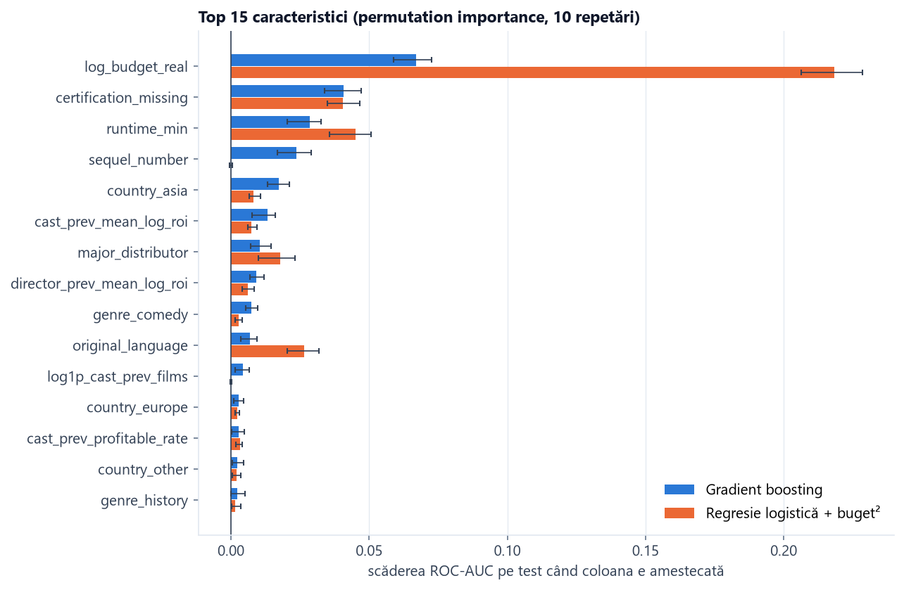
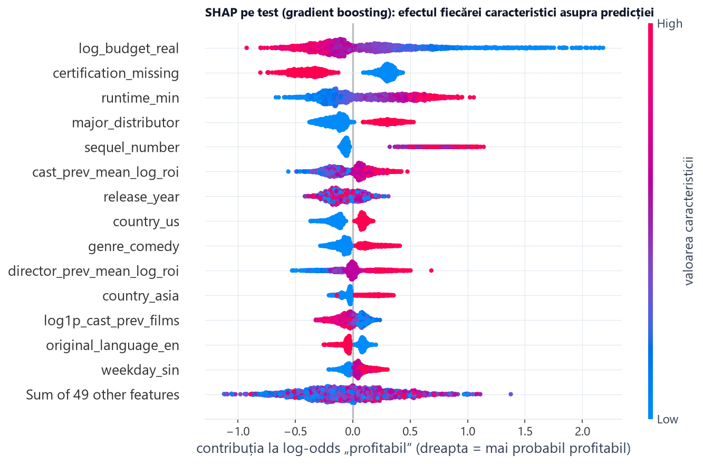
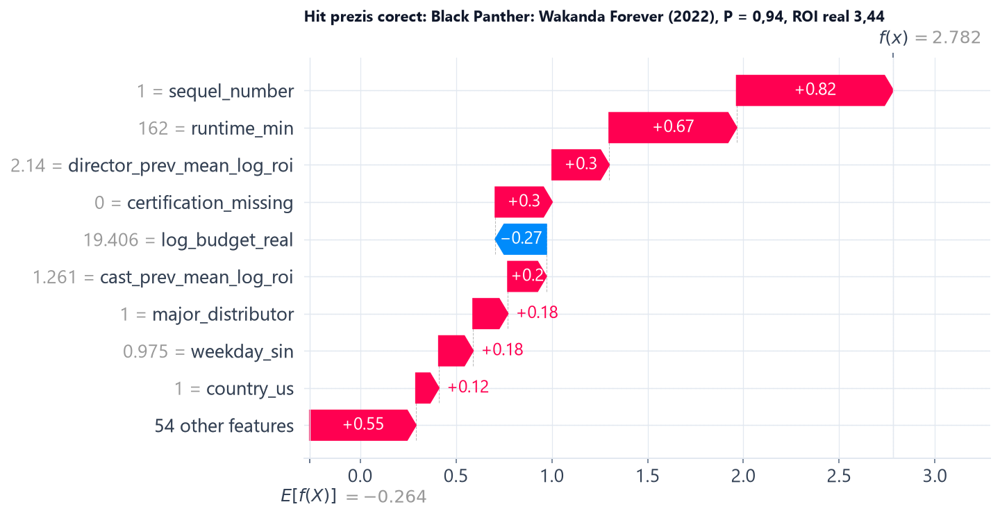
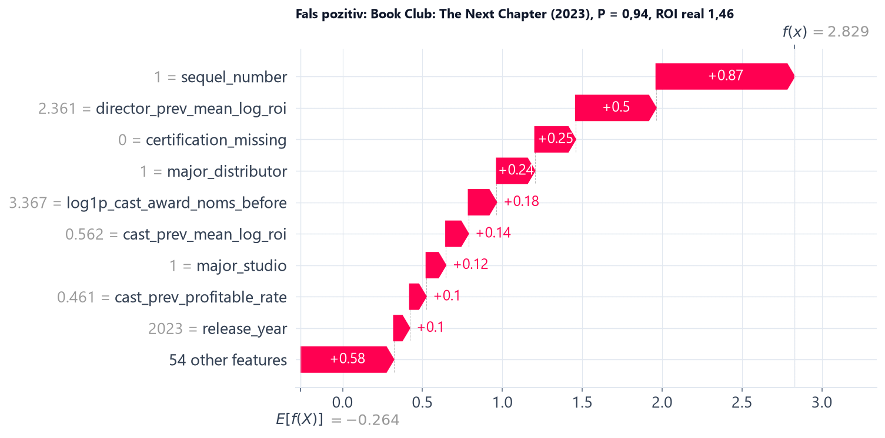
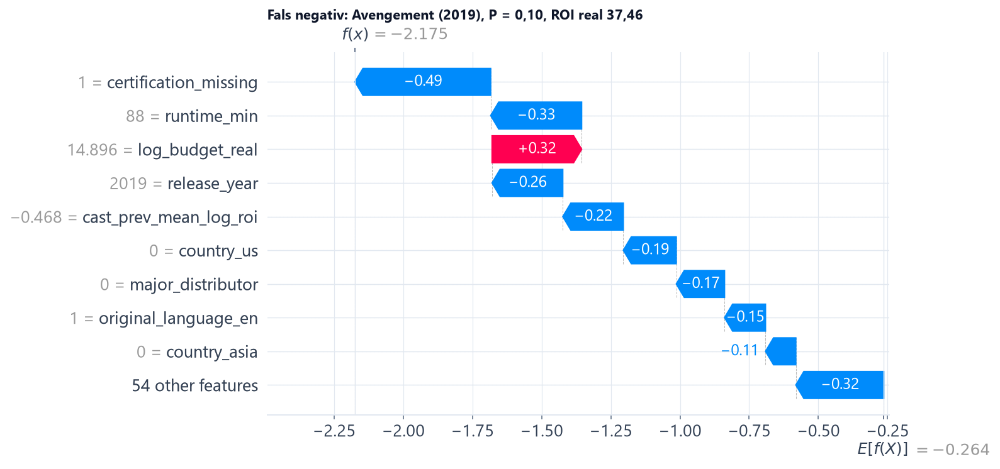
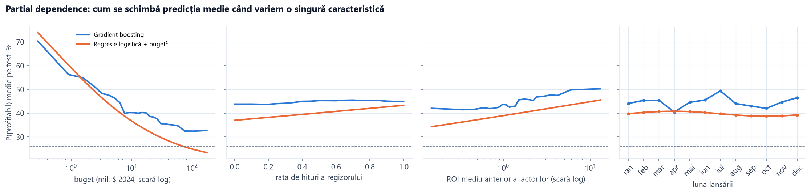

# Interpretabilitate (#58)

Generat cu `python analysis/interpret.py`. Tabelele complete: `results/interpret/*.csv`. Modelele sunt antrenate pe train (1950–2014) cu hiperparametrii din #41; toate măsurătorile sunt pe **test** (2019–2024), pe filme pe care modelul nu le-a văzut.

## Pe scurt

1. **Bugetul e cea mai importantă caracteristică** în ambele modele. Amestecat, scade ROC-AUC cu 0,067
   la gradient boosting și cu 0,218 la regresia logistică + buget² (care depinde mai mult de el). Are și
   cel mai mare |SHAP| mediu.
2. **Forma de U din EDA nu e un efect direct al bugetului.** Ținând restul caracteristicilor fixe,
   probabilitatea scade aproape continuu cu bugetul: de la 0,70 (sub 0,3 mil. $) la 0,32 (peste 100 mil. $)
   la gradient boosting, și de la 0,74 la 0,23 la regresia logistică. Brațul drept al U-ului (filmele
   foarte scumpe, mai des profitabile) vine din ce **însoțește** bugetul mare: continuări, francize,
   distribuitori majori. Odată ce modelul știe acestea, un buget mai mare înseamnă doar un prag mai greu
   de atins. Brațul stâng (filmele foarte ieftine) e real: un film de 300.000 $ are nevoie doar de
   750.000 $ încasări pentru ROI 2,5.
3. **Lipsa clasificării americane (`certification_missing`) e a doua caracteristică**, în ambele modele
   (scădere ROC-AUC 0,041). Confirmă EDA (#42): lipsa clasificării e ea însăși o informație (filme fără
   lansare clasificată în SUA, de obicei mai mici). Decizia din #40 de a păstra indicatorul se dovedește
   utilă.
4. **Durata, continuările și distribuitorul major** urmează în clasament. La gradient boosting,
   `sequel_number` face toată treaba francizei: o continuare ridică probabilitatea medie de la 0,43 la
   0,56, iar `is_franchise` nu mai adaugă nimic (aceeași predicție cu 0 sau 1), pentru că informația e
   deja în `sequel_number`. Regresia logistică, invers, folosește `is_franchise` (coeficient +0,85).
5. **Istoricul actorilor și al regizorului contează, dar mai puțin decât sugera EDA.** Amestecat, ROI-ul
   mediu anterior al actorilor scade ROC-AUC cu 0,013, al regizorului cu 0,009. O parte din importanță e
   împărțită cu perechea lor corelată (`*_profitable_rate`).
6. **Luna lansării are un efect mic:** iulie e cea mai bună lună (P medie 0,49), aprilie cea mai slabă
   (0,41). Diferența e de 8 puncte procentuale, mult sub efectul bugetului.
7. **Modelul e de acord cu EDA doar parțial:** corelația dintre importanța SHAP și informația mutuală e
   ρ = 0,47. Bugetul, anul, durata și istoricul sunt în top 10 la ambele. Modelul folosește în plus
   indicatori pe care MI îi subestima luați separat (`certification_missing`, `sequel_number`,
   `major_distributor`), pentru că efectul lor apare în combinație cu bugetul.

## 1. Permutation importance

Pentru fiecare coloană de intrare: amestecăm valorile ei între filmele de test (10 repetări) și măsurăm cât scade ROC-AUC. Dacă scade mult, modelul se bazează pe ea. Intervalul e dat de cele 10 repetări.

| caracteristică | scădere ROC-AUC (Gradient boosting) | IC 95% (GB) | scădere ROC-AUC (Regresie logistică + buget²) |
|---|---|---|---|
| log_budget_real | 0,0669 | [0,0588; 0,0727] | 0,2184 |
| certification_missing | 0,0408 | [0,0340; 0,0471] | 0,0405 |
| runtime_min | 0,0285 | [0,0203; 0,0327] | 0,0451 |
| sequel_number | 0,0237 | [0,0167; 0,0292] | 0,0001 |
| country_asia | 0,0173 | [0,0131; 0,0213] | 0,0081 |
| cast_prev_mean_log_roi | 0,0132 | [0,0076; 0,0162] | 0,0074 |
| major_distributor | 0,0106 | [0,0072; 0,0144] | 0,0177 |
| director_prev_mean_log_roi | 0,0092 | [0,0069; 0,0121] | 0,0060 |
| genre_comedy | 0,0075 | [0,0052; 0,0096] | 0,0028 |
| original_language | 0,0070 | [0,0036; 0,0095] | 0,0264 |
| log1p_cast_prev_films | 0,0044 | [0,0016; 0,0067] | 0,0000 |
| country_europe | 0,0029 | [0,0011; 0,0045] | 0,0023 |
| cast_prev_profitable_rate | 0,0027 | [0,0003; 0,0048] | 0,0032 |
| country_other | 0,0023 | [0,0005; 0,0045] | 0,0021 |
| genre_history | 0,0023 | [-0,0001; 0,0051] | 0,0015 |

Limită: coloanele corelate (de ex. `director_prev_mean_log_roi` și `director_prev_profitable_rate`, ρ = 0,84) își împart importanța: amestecând una, modelul o mai poate folosi pe cealaltă, deci fiecare pare mai puțin importantă decât e informația comună.

**Coeficienții regresiei logistice + buget²** (pe date scalate, deci comparabili între ei; top 15 în modul):

| coloană | coeficient (date scalate) |
|---|---|
| log_budget_real | -2,728 |
| log_budget_real_sq | 2,064 |
| certification_missing | -0,877 |
| is_franchise | 0,845 |
| original_language_ko | 0,708 |
| genre_documentary | 0,694 |
| major_distributor | 0,572 |
| genre_history | -0,572 |
| original_language_en | -0,501 |
| adaptation_type_film | 0,486 |
| genre_animation | 0,477 |
| adaptation_type_infrequent_sklearn | 0,457 |
| adaptation_type_stage | -0,448 |
| country_us | 0,415 |
| runtime_min | 0,393 |

`log_budget_real` și `log_budget_real_sq` trebuie citite împreună: un coeficient negativ pe buget și unul pozitiv pe pătratul lui descriu un U.

## 2. SHAP (gradient boosting)

SHAP împarte predicția fiecărui film între caracteristici: cât a împins fiecare predicția spre „profitabil” (dreapta) sau „neprofitabil” (stânga), față de media modelului. Fiecare punct e un film din test; culoarea e valoarea caracteristicii (roșu = mare, albastru = mică).

**Trei filme explicate:** cele mai mari contribuții, de la media modelului (jos, E[f(x)]) până la predicția pentru film (sus, f(x)), în log-odds.

## 3. Partial dependence

Pentru o caracteristică: dăm aceeași valoare tuturor filmelor din test, păstrând restul neschimbat, și calculăm probabilitatea medie prezisă. Linia punctată: rata reală de profitabile din test.

**Bugetul (gradient boosting):**

| buget (mil. $ 2024) | P(profitabil) medie |
|---|---|
| 0,279 | 0,703 |
| 0,896 | 0,563 |
| 1,557 | 0,549 |
| 2,345 | 0,515 |
| 3,183 | 0,483 |
| 4,100 | 0,477 |
| 5,192 | 0,464 |
| 6,348 | 0,444 |
| 7,591 | 0,399 |
| 9,018 | 0,403 |
| 10,761 | 0,402 |
| 12,822 | 0,400 |
| 14,747 | 0,403 |
| 17,250 | 0,401 |
| 19,673 | 0,386 |
| 22,773 | 0,384 |
| 26,319 | 0,376 |
| 30,258 | 0,356 |
| 34,864 | 0,356 |
| 40,622 | 0,352 |
| 48,109 | 0,351 |
| 58,123 | 0,346 |
| 74,734 | 0,325 |
| 103,791 | 0,324 |
| 174,319 | 0,327 |

Minimul e la aproximativ 103,8 mil. $ (P = 0,324).

**Luna lansării (gradient boosting):**

| luna | P(profitabil) medie |
|---|---|
| ian | 0,441 |
| feb | 0,454 |
| mar | 0,454 |
| apr | 0,405 |
| mai | 0,446 |
| iun | 0,455 |
| iul | 0,494 |
| aug | 0,440 |
| sep | 0,430 |
| oct | 0,420 |
| nov | 0,447 |
| dec | 0,465 |

**Franciza:**

| model | is_franchise = 0 | is_franchise = 1 |
|---|---|---|
| Gradient boosting | 0,448 | 0,448 |
| Regresie logistică + buget² | 0,374 | 0,548 |

## 4. Comparație cu EDA

Corelația Spearman între importanța SHAP (pe test) și informația mutuală din EDA (#42, pe train), pe cele 63 coloane comune: ρ = 0,47 (p = 1.1e-04).

- În top 10 la ambele: `cast_prev_mean_log_roi`, `director_prev_mean_log_roi`, `log_budget_real`, `release_year`, `runtime_min`.
- Doar în top 10 SHAP: `certification_missing`, `country_us`, `genre_comedy`, `major_distributor`, `sequel_number`.
- Doar în top 10 MI: `cast_prev_profitable_rate`, `country_europe`, `director_prev_profitable_rate`, `is_franchise`, `log_budget`.
