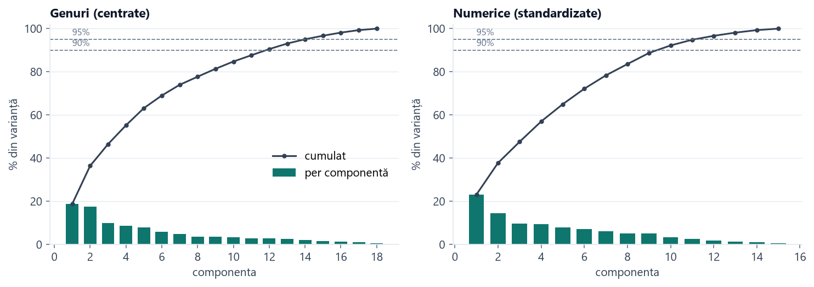
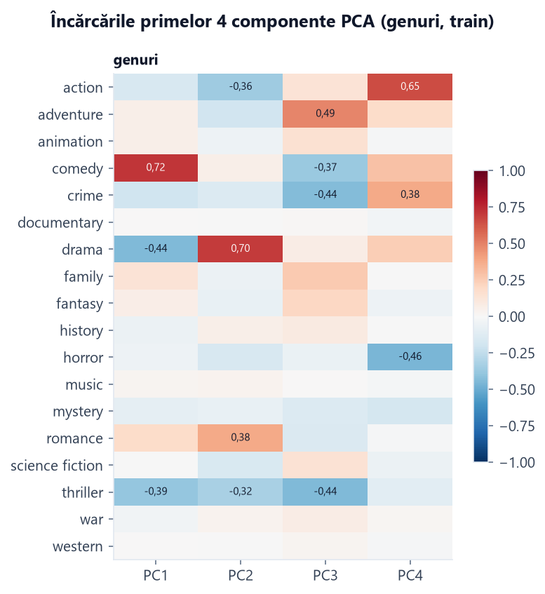
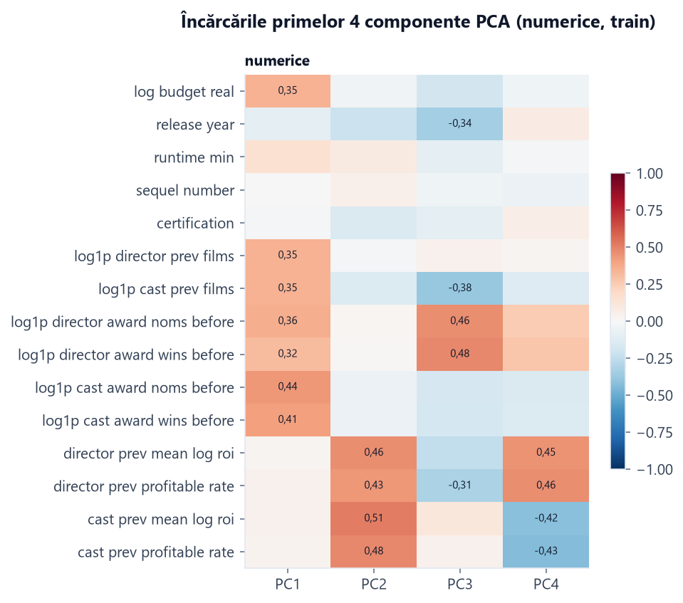
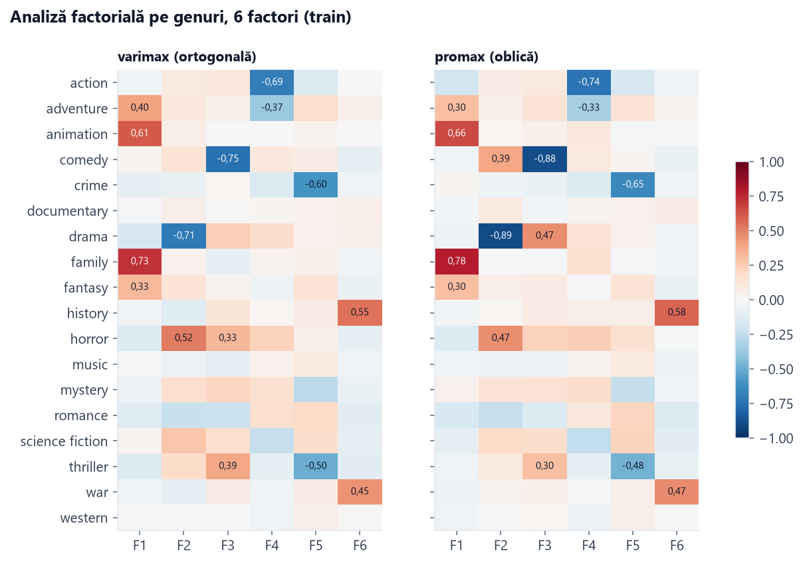
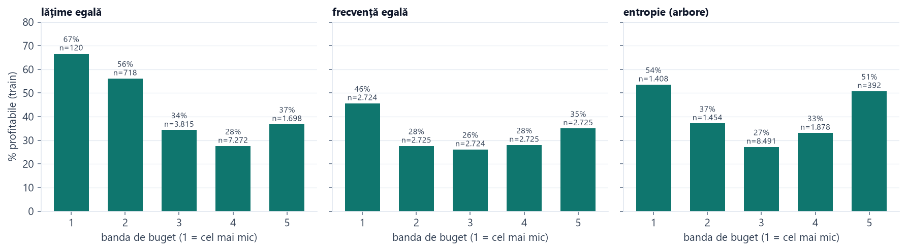

# Reducerea dimensiunii și discretizare (#43)

Generat cu `python analysis/reduction.py`. Tabelele complete: `results/reduction/*.csv`. Totul (PCA, factori, limitele benzilor) e ajustat **doar pe train** (1950–2014, 13.623 filme). Modelele folosesc hiperparametrii aleși pe validare în #41; pragul de decizie se alege tot pe validare, iar scorurile sunt pe test (2019–2024).

## Pe scurt

1. **PCA nu reduce mult și nu ajută modelele.** La genuri, prima componentă explică doar 18,8%
   din varianță și sunt nevoie de 12 din 18 componente pentru 90%: genurile sunt aproape independente
   între ele (un film are în medie 2–3 genuri, în combinații foarte variate). Înlocuirea genurilor cu
   3, 5 sau 12 componente dă același ROC-AUC (0,772–0,775) ca one-hot-ul, la ambele modele.
   **Decizie: păstrăm cele 18 coloane de gen**, mai ușor de interpretat; 18 coloane nu sunt o problemă
   pentru 13.623 de filme.
2. **Componentele au sens și sunt stabile:** la genuri, primele 5 componente se regăsesc în toate
   cele 100 de eșantioane bootstrap (cos ≥ 0,95). PC1 opune comedia dramei și thriller-ului. La
   numerice, PC1 = „notorietate” (premii + buget), PC2 = „istoric de succes” (ROI-ul anterior al
   regizorului și al actorilor), ambele foarte stabile; de la PC3 încolo componentele se rotesc între
   eșantioane (cos minim 0,03–0,32), pentru că au valori proprii apropiate: nu le interpretăm.
3. **Analiza factorială găsește „teme” de gen recognoscibile:** filme pentru copii (family +
   animation), acțiune / aventură / SF, crimă / thriller / mister, istoric / război. Promax arată că
   factorii nu sunt independenți (corelație până la 0,51). KMO = 0,58 e însă „slab”, iar genurile 0/1
   nu respectă ipotezele modelului: rezultatul e descriptiv, nu intră în model.
4. **Discretizarea bugetului face vizibilă forma de U**, cel mai clar la benzile pe bază de entropie:
   53,6% profitabile sub 1,6 mil. $, 27,2% între 3,9 și 51,2 mil. $, 50,8% peste 149,9 mil. $ (dolari
   2024). În model însă **benzile nu bat bugetul continuu** (ROC-AUC 0,763–0,769 vs 0,774 la regresia
   logistică): se pierde informație în interiorul benzii. Pentru modelul liniar, forma de U se prinde
   mai bine cu bugetul la pătrat (F1 0,563). **Decizie: bugetul rămâne continuu.**
5. **Pragul ROI:** ROC-AUC rămâne 0,77–0,79 la toate cele trei praguri, deci modelul ordonează filmele
   la fel de bine. F1 scade când pragul crește (0,60 → 0,55 → 0,51–0,53), pentru că filmele
   „profitabile” devin mai rare (31,5% → 26,1% → 22,1% în test). Rezultatele finale (#56) se raportează
   la toate cele trei praguri.

## 1. PCA

Două blocuri, separat: **genurile** (18 coloane 0/1, aceeași scară, deci doar centrate) și **numericele** (15 coloane după imputare, standardizate pentru că au scări diferite: buget în log, ani, minute, proporții). Sin/cos pentru lună și zi nu intră: au sens doar ca pereche.

| bloc | variabile | PC1 % | componente 90% | componente 95% | Kaiser |
|---|---|---|---|---|---|
| genuri (18, 0/1) | 18 | 18,8% | 12 | 14 | 6 |
| numerice (15) | 15 | 23,2% | 10 | 12 | 6 |

Criteriul Kaiser: componentele cu valoare proprie peste medie (pe date standardizate, peste 1).

**Ce înseamnă primele componente (genuri):** încărcările cele mai mari, în modul.

- **PC1**: comedy (0,72), drama (-0,44), thriller (-0,39), crime (-0,20)
- **PC2**: drama (0,70), romance (0,38), action (-0,36), thriller (-0,32)
- **PC3**: adventure (0,49), thriller (-0,44), crime (-0,44), comedy (-0,37)
- **PC4**: action (0,65), horror (-0,46), crime (0,38), comedy (0,29)

**Numerice:**

- **PC1**: log1p cast award noms before (0,44), log1p cast award wins before (0,41), log1p director award noms before (0,36), log budget real (0,35)
- **PC2**: cast prev mean log roi (0,51), cast prev profitable rate (0,48), director prev mean log roi (0,46), director prev profitable rate (0,43)
- **PC3**: log1p director award wins before (0,48), log1p director award noms before (0,46), log1p cast prev films (-0,38), release year (-0,34)
- **PC4**: director prev profitable rate (0,46), director prev mean log roi (0,45), cast prev profitable rate (-0,43), cast prev mean log roi (-0,42)

**Stabilitate prin bootstrap** (100 eșantioane din train, cu înlocuire): cosinusul (în modul, semnul unei componente e arbitrar) dintre componenta din eșantion și cea de referință; 1 = aceeași direcție.

Genuri:

| componentă | cos mediu (modul) | cos minim (modul) | % bootstrap cu cos ≥ 0,9 |
|---|---|---|---|
| PC1 | 0,993 | 0,955 | 100,0% |
| PC2 | 0,993 | 0,956 | 100,0% |
| PC3 | 0,997 | 0,976 | 100,0% |
| PC4 | 0,993 | 0,946 | 100,0% |
| PC5 | 0,995 | 0,947 | 100,0% |

Numerice:

| componentă | cos mediu (modul) | cos minim (modul) | % bootstrap cu cos ≥ 0,9 |
|---|---|---|---|
| PC1 | 1,000 | 0,999 | 100,0% |
| PC2 | 0,999 | 0,997 | 100,0% |
| PC3 | 0,944 | 0,315 | 88,0% |
| PC4 | 0,937 | 0,179 | 87,0% |
| PC5 | 0,889 | 0,030 | 83,0% |

## 2. Analiză factorială (genuri)

- **Adecvarea eșantionului:** KMO = 0,577 (sub 0,5 = nepotrivit, 0,5–0,6 slab, peste 0,6 acceptabil). Testul Bartlett (corelațiile nu sunt toate zero): χ² = 26.330, p < 1e-300. Eșantionul (13.623 filme pentru 18 variabile, peste 700 de filme per variabilă) e mai mult decât suficient ca mărime.
- KMO pe variabile, cele mai mici: western (0,22), documentary (0,23), comedy (0,44), horror (0,46).
- **6 factori** (numărul dat de Kaiser la PCA pe genuri), estimați cu `FactorAnalysis` (sklearn). Limită: genurile sunt 0/1, iar analiza factorială clasică presupune variabile continue; corelațiile Pearson între variabile binare subestimează legăturile (corelația tetracorică ar fi mai potrivită). Rezultatul e descriptiv, nu intră în model.
- **Varimax** (ortogonală: factorii rămân necorelați) vs **promax** (oblică: factorii se pot corela, mai realist pentru genuri care apar împreună).

- **F1** (promax): family (0,78), animation (0,66), adventure (0,30), fantasy (0,30)
- **F2** (promax): drama (-0,89), horror (0,47), comedy (0,39), romance (-0,23)
- **F3** (promax): comedy (-0,88), drama (0,47), thriller (0,30), horror (0,23)
- **F4** (promax): action (-0,74), adventure (-0,33), science fiction (-0,25), horror (0,25)
- **F5** (promax): crime (-0,65), thriller (-0,48), mystery (-0,24), science fiction (0,22)
- **F6** (promax): history (0,58), war (0,47), romance (-0,14), science fiction (-0,11)

**Corelațiile dintre factori după promax** (la varimax sunt zero prin construcție):

| factor | F1 | F2 | F3 | F4 | F5 | F6 |
|---|---|---|---|---|---|---|
| F1 | 1,00 | 0,10 | -0,14 | -0,39 | 0,34 | -0,00 |
| F2 | 0,10 | 1,00 | 0,51 | -0,04 | -0,07 | -0,37 |
| F3 | -0,14 | 0,51 | 1,00 | 0,06 | -0,26 | -0,05 |
| F4 | -0,39 | -0,04 | 0,06 | 1,00 | -0,12 | -0,13 |
| F5 | 0,34 | -0,07 | -0,26 | -0,12 | 1,00 | 0,09 |
| F6 | -0,00 | -0,37 | -0,05 | -0,13 | 0,09 | 1,00 |

## 3. Discretizarea bugetului

Bugetul ajustat (`log_budget_real`) în **5 benzi**, cu limitele învățate pe train, în trei feluri: **lățime egală** (pe scara log), **frecvență egală** (cuantile, câte 20% din filme) și **pe bază de entropie** (pragurile unui arbore de decizie cu 5 frunze care separă filmele profitabile de cele neprofitabile).

| discretizare | banda | buget (mil. $ 2024) | filme (train) | % profitabile |
|---|---|---|---|---|
| lățime egală | 1 | 0,0 – 0,1 | 120 | 66,7% |
| lățime egală | 2 | 0,1 – 0,9 | 718 | 56,1% |
| lățime egală | 3 | 0,9 – 7,6 | 3.815 | 34,4% |
| lățime egală | 4 | 7,6 – 63,5 | 7.272 | 27,6% |
| lățime egală | 5 | 63,5 – ∞ | 1.698 | 36,8% |
| frecvență egală | 1 | 0,0 – 3,6 | 2.724 | 45,6% |
| frecvență egală | 2 | 3,6 – 9,9 | 2.725 | 27,6% |
| frecvență egală | 3 | 9,9 – 21,2 | 2.724 | 26,1% |
| frecvență egală | 4 | 21,2 – 43,8 | 2.725 | 28,0% |
| frecvență egală | 5 | 43,8 – ∞ | 2.725 | 35,0% |
| entropie (arbore) | 1 | 0,0 – 1,6 | 1.408 | 53,6% |
| entropie (arbore) | 2 | 1,6 – 3,9 | 1.454 | 37,1% |
| entropie (arbore) | 3 | 3,9 – 51,2 | 8.491 | 27,2% |
| entropie (arbore) | 4 | 51,2 – 149,9 | 1.878 | 33,1% |
| entropie (arbore) | 5 | 149,9 – ∞ | 392 | 50,8% |

**În model** (bugetul continuu înlocuit de banda lui, one-hot; restul caracteristicilor neschimbate; pe test):

| reprezentare buget | model | F1 | ROC-AUC | PR-AUC | precision | recall | prag |
|---|---|---|---|---|---|---|---|
| continuu (log_budget_real) | Regresie logistică | 0,544 | 0,774 | 0,555 | 0,401 | 0,844 | 0,390 |
| continuu + pătrat | Regresie logistică | 0,563 | 0,769 | 0,531 | 0,461 | 0,721 | 0,430 |
| 5 benzi, lățime egală | Regresie logistică | 0,535 | 0,763 | 0,540 | 0,398 | 0,815 | 0,380 |
| 5 benzi, frecvență egală | Regresie logistică | 0,535 | 0,766 | 0,540 | 0,416 | 0,750 | 0,420 |
| 5 benzi, entropie (arbore) | Regresie logistică | 0,543 | 0,769 | 0,537 | 0,412 | 0,795 | 0,390 |
| continuu (log_budget_real) | Gradient boosting | 0,555 | 0,775 | 0,527 | 0,428 | 0,788 | 0,450 |
| 5 benzi, lățime egală | Gradient boosting | 0,553 | 0,770 | 0,515 | 0,422 | 0,803 | 0,440 |
| 5 benzi, frecvență egală | Gradient boosting | 0,542 | 0,766 | 0,517 | 0,417 | 0,774 | 0,440 |
| 5 benzi, entropie (arbore) | Gradient boosting | 0,546 | 0,766 | 0,516 | 0,400 | 0,857 | 0,390 |

## 4. Modele cu componente PCA în loc de genuri

Cele 18 coloane de gen înlocuite de primele k componente PCA (ajustate pe train în pipeline), restul caracteristicilor neschimbate; pe test.

| genuri | model | F1 | ROC-AUC | PR-AUC | precision | recall | prag |
|---|---|---|---|---|---|---|---|
| 18 coloane 0/1 (#41) | Regresie logistică | 0,544 | 0,774 | 0,555 | 0,401 | 0,844 | 0,390 |
| 3 componente PCA | Regresie logistică | 0,558 | 0,773 | 0,550 | 0,424 | 0,813 | 0,420 |
| 5 componente PCA | Regresie logistică | 0,532 | 0,772 | 0,550 | 0,390 | 0,835 | 0,390 |
| 12 componente PCA (90%) | Regresie logistică | 0,560 | 0,773 | 0,560 | 0,442 | 0,766 | 0,440 |
| 18 coloane 0/1 (#41) | Gradient boosting | 0,555 | 0,775 | 0,527 | 0,428 | 0,788 | 0,450 |
| 3 componente PCA | Gradient boosting | 0,554 | 0,775 | 0,526 | 0,423 | 0,803 | 0,440 |
| 5 componente PCA | Gradient boosting | 0,551 | 0,774 | 0,522 | 0,418 | 0,810 | 0,430 |
| 12 componente PCA (90%) | Gradient boosting | 0,553 | 0,775 | 0,525 | 0,443 | 0,736 | 0,480 |

## 5. Pragul ROI: 2 / 2,5 / 3

Ținta `profitable` recalculată la fiecare prag; aceleași modele și hiperparametri (aleși la 2,5 în #41), pragul de decizie ales din nou pe validare.

| prag ROI | % profitabile (tot) | % profitabile (test) | model | F1 | ROC-AUC | PR-AUC | precision | recall | prag |
|---|---|---|---|---|---|---|---|---|---|
| 2,0 | 38,5% | 31,5% | Regresie logistică | 0,606 | 0,787 | 0,632 | 0,473 | 0,841 | 0,410 |
| 2,0 | 38,5% | 31,5% | Gradient boosting | 0,596 | 0,781 | 0,622 | 0,460 | 0,847 | 0,410 |
| 2,5 | 31,9% | 26,1% | Regresie logistică | 0,544 | 0,774 | 0,555 | 0,401 | 0,844 | 0,390 |
| 2,5 | 31,9% | 26,1% | Gradient boosting | 0,555 | 0,775 | 0,527 | 0,428 | 0,788 | 0,450 |
| 3,0 | 26,8% | 22,1% | Regresie logistică | 0,525 | 0,778 | 0,507 | 0,407 | 0,739 | 0,440 |
| 3,0 | 26,8% | 22,1% | Gradient boosting | 0,505 | 0,771 | 0,473 | 0,377 | 0,763 | 0,460 |
