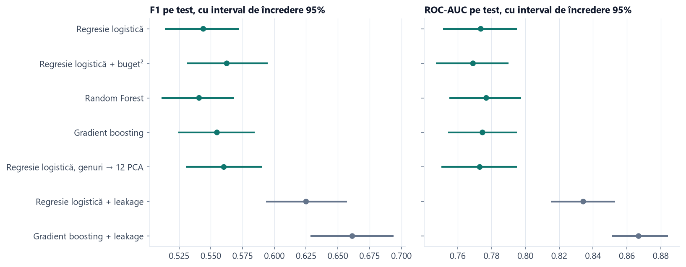
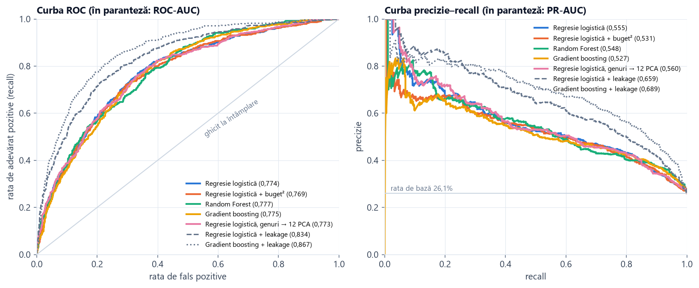

# Rezultate: comparația finală a modelelor (#56)

Generat cu `python modeling/compare.py`. Tabele: `results/final_metrics.csv`, `results/compare/*.csv`; probabilitățile pe test ale fiecărui model: `results/compare/test_predictions.csv` (pentru analiza erorilor, #57).

## Protocol

- **Același test pentru toate modelele:** filmele din 2019–2024 (2.118 filme, 26,1% profitabile), folosite o singură dată. Antrenare pe 1950–2014 (13.623 filme); hiperparametrii (#41) și pragul de decizie aleși pe 2015–2018 (2.313 filme).
- **Intervale de încredere 95%** prin bootstrap pe test: 1000 de eșantioane de filme cu înlocuire, aceleași pentru toate modelele, deci diferențele dintre modele sunt calculate pe aceleași filme.
- **Testul McNemar** compară două clasificatoare pe filmele unde exact unul dintre ele greșește. Dacă modelele sunt la fel de bune, cele două tipuri de dezacord ar trebui să fie cam la fel de frecvente.
- Varianta principală e **fără leakage**; modelele cu voturi + keywords TMDB apar doar ca referință (gri / „+ leakage”).

## Clasificare: `profitable` (ROI ≥ 2,5)

| model | F1 (IC 95%) | ROC-AUC (IC 95%) | PR-AUC | precision | recall | accuracy | prag |
|---|---|---|---|---|---|---|---|
| Dummy (clasa majoritară) | 0,00 [0,00; 0,00] | 0,50 [0,50; 0,50] | 0,261 | 0,000 | 0,000 | 0,739 | 0,500 |
| Regresie logistică | 0,54 [0,51; 0,57] | 0,77 [0,75; 0,79] | 0,555 | 0,401 | 0,844 | 0,631 | 0,390 |
| Regresie logistică + buget² | 0,56 [0,53; 0,59] | 0,77 [0,75; 0,79] | 0,531 | 0,461 | 0,721 | 0,708 | 0,430 |
| Random Forest | 0,54 [0,51; 0,57] | 0,78 [0,76; 0,80] | 0,548 | 0,396 | 0,853 | 0,622 | 0,390 |
| Gradient boosting | 0,55 [0,52; 0,58] | 0,77 [0,75; 0,80] | 0,527 | 0,428 | 0,788 | 0,670 | 0,450 |
| Regresie logistică, genuri → 12 PCA | 0,56 [0,53; 0,59] | 0,77 [0,75; 0,80] | 0,560 | 0,442 | 0,766 | 0,686 | 0,440 |
| Regresie logistică + leakage | 0,62 [0,59; 0,66] | 0,83 [0,82; 0,85] | 0,659 | 0,566 | 0,697 | 0,782 | 0,480 |
| Gradient boosting + leakage | 0,66 [0,63; 0,69] | 0,87 [0,85; 0,88] | 0,689 | 0,648 | 0,676 | 0,820 | 0,600 |

## Sunt diferențele reale?

| A | B | A corect, B greșit | A greșit, B corect | χ² (corecție de continuitate) | p (χ²) | p (exact, binomial) | Δ ROC-AUC (A − B) | Δ ROC-AUC IC | Δ F1 (A − B) | Δ F1 IC |
|---|---|---|---|---|---|---|---|---|---|---|
| Random Forest | Gradient boosting | 77 | 179 | 39,848 | 2.7e-10 | 1.6e-10 | 0,002 | [-0,01; 0,01] | -0,014 | [-0,03; 0,00] |
| Regresie logistică + buget² | Random Forest | 316 | 135 | 71,840 | 2.3e-17 | 8.4e-18 | -0,007 | [-0,02; 0,01] | 0,022 | [-0,00; 0,05] |
| Random Forest | Dummy (clasa majoritară) | 471 | 719 | 51,268 | 8.1e-13 | 6.7e-13 | 0,277 | [0,26; 0,30] | 0,541 | [0,51; 0,57] |

Δ = diferența medie pe cele 1000 de eșantioane bootstrap; IC = intervalul de 95% al diferenței. Dacă intervalul conține 0, diferența nu e semnificativă.

## Regresie: `log_roi`

| model | RMSE log_roi | RMSE IC | MAE log_roi | R² log_roi | R² IC | MedAE ROI |
|---|---|---|---|---|---|---|
| Dummy (mediana) | 2,013 | [1,94; 2,08] | 1,509 | -0,133 | [-0,16; -0,11] | 1,154 |
| Ridge | 1,644 | [1,59; 1,70] | 1,251 | 0,245 | [0,22; 0,27] | 0,568 |
| Ridge + buget² | 1,636 | [1,58; 1,69] | 1,255 | 0,252 | [0,22; 0,28] | 0,545 |
| Random Forest | 1,650 | [1,58; 1,71] | 1,224 | 0,239 | [0,21; 0,27] | 0,706 |
| Gradient boosting | 1,666 | [1,60; 1,73] | 1,243 | 0,224 | [0,18; 0,26] | 0,759 |
| Ridge + leakage | 1,525 | [1,47; 1,58] | 1,161 | 0,350 | [0,32; 0,38] | 0,525 |
| Gradient boosting + leakage | 1,440 | [1,38; 1,50] | 1,041 | 0,420 | [0,38; 0,46] | 0,574 |

## Pragurile ROI 2 / 2,5 / 3

Ținta recalculată la fiecare prag; aceiași hiperparametri, pragul de decizie ales din nou pe validare.

| prag ROI | % profitabile (test) | model | F1 | F1 IC | ROC-AUC | ROC-AUC IC | PR-AUC |
|---|---|---|---|---|---|---|---|
| 2,0 | 31,5% | Regresie logistică | 0,606 | [0,58; 0,63] | 0,787 | [0,77; 0,81] | 0,632 |
| 2,0 | 31,5% | Regresie logistică + buget² | 0,612 | [0,58; 0,64] | 0,785 | [0,76; 0,80] | 0,615 |
| 2,0 | 31,5% | Random Forest | 0,605 | [0,58; 0,63] | 0,787 | [0,77; 0,81] | 0,633 |
| 2,0 | 31,5% | Gradient boosting | 0,596 | [0,57; 0,62] | 0,781 | [0,76; 0,80] | 0,622 |
| 2,5 | 26,1% | Regresie logistică | 0,544 | [0,51; 0,57] | 0,774 | [0,75; 0,79] | 0,555 |
| 2,5 | 26,1% | Regresie logistică + buget² | 0,563 | [0,53; 0,59] | 0,769 | [0,75; 0,79] | 0,531 |
| 2,5 | 26,1% | Random Forest | 0,541 | [0,51; 0,57] | 0,777 | [0,76; 0,80] | 0,548 |
| 2,5 | 26,1% | Gradient boosting | 0,555 | [0,52; 0,58] | 0,775 | [0,75; 0,80] | 0,527 |
| 3,0 | 22,1% | Regresie logistică | 0,525 | [0,49; 0,56] | 0,778 | [0,75; 0,80] | 0,507 |
| 3,0 | 22,1% | Regresie logistică + buget² | 0,520 | [0,49; 0,55] | 0,773 | [0,75; 0,80] | 0,478 |
| 3,0 | 22,1% | Random Forest | 0,510 | [0,48; 0,54] | 0,777 | [0,75; 0,80] | 0,493 |
| 3,0 | 22,1% | Gradient boosting | 0,505 | [0,47; 0,53] | 0,771 | [0,75; 0,79] | 0,473 |

## Concluzii

1. **Nu există un câștigător clar între modelele reale.** Toate au ROC-AUC 0,77–0,78 și F1 0,54–0,56,
   iar intervalele de încredere se suprapun aproape complet. Diferențele perechi pe bootstrap conțin 0:
   Random Forest vs gradient boosting (ROC-AUC +0,002, IC [−0,01; 0,01]), regresia logistică + buget²
   vs Random Forest (F1 +0,022, IC [−0,00; 0,05]). Pe datele noastre, un model liniar simplu, cu bugetul
   la pătrat, e la fel de bun ca un ansamblu de arbori, și e mai ușor de explicat.
2. **Toate bat clar baseline-ul:** ROC-AUC +0,28 (IC [0,26; 0,30]) și F1 +0,54 față de Dummy. Acuratețea
   spune povestea inversă: Dummy are 73,9%, iar Random Forest 62,2%, pentru că Dummy nu spune
   niciodată „profitabil”. De aceea acuratețea nu e metrica după care alegem.
3. **McNemar iese semnificativ chiar când F1 și ROC-AUC nu diferă.** Testul compară greșelile la
   pragul ales al fiecărui model, adică acuratețea. Modelele au praguri diferite (0,39 vs 0,45):
   unul spune „profitabil” mai des și greșește pe alte filme. McNemar arată că modelele **se comportă
   diferit**, nu că unul e mai bun: diferența ține de alegerea pragului (precizie vs recall), nu de
   cât de bine ordonează modelele filmele.
4. **Leakage:** cu voturile și keywords TMDB, ROC-AUC urcă la 0,83 (regresie logistică) și 0,87
   (gradient boosting), cu intervale care nu se suprapun cu modelele fără leakage. Câștigul de
   aproximativ 0,1 e exact informația care nu există înainte de lansare.
5. **Regresie:** R² ≈ 0,25 (IC [0,22; 0,28] la Ridge + buget²). Modelele liniare au eroarea mediană pe
   ROI mai mică (0,55 vs 0,71–0,76 la arbori): arborii greșesc mai mult la filmul obișnuit.
6. **Pragul ROI:** ROC-AUC rămâne 0,77–0,79 la 2, 2,5 și 3, cu intervale care se suprapun; F1 scade odată
   cu pragul (≈ 0,60 → 0,55 → 0,51), pentru că filmele „profitabile” devin mai rare (31,5% → 22,1% în
   test). Clasamentul modelelor nu se schimbă semnificativ la niciun prag.
7. **Modelul de referință pentru restul proiectului** (analiza erorilor #57, interpretabilitatea #58):
   **gradient boosting** pentru interpretabilitate (prinde interacțiuni și forma de U fără coloane
   construite manual) și **regresia logistică + buget²** ca model simplu de comparație.
